<div align="center">

<picture>
  <source media="(prefers-color-scheme: dark)" srcset="docs/img/logo-dark.svg">
  
</picture>

**Python toolkit that downloads financial data from several sources, brings it into a common format,
analyses portfolios, runs Monte Carlo scenarios and generates reports, with a dashboard that works offline.**

[](https://github.com/raaauulg/portfolio-risk-toolkit/actions/workflows/ci.yml)
[](pyproject.toml)
[](LICENSE)
[](#testing)
[](https://portfolio-risk-toolkit.streamlit.app/?preset=demo)
[](pyproject.toml)

[**Live demo**](https://portfolio-risk-toolkit.streamlit.app/?preset=demo) · [Quick start](#quick-start) · [Usage](#library-usage) · [Dashboard](#dashboard) · [Architecture](#architecture) · [How it works](#how-it-works) · [Roadmap](#roadmap) · [License](#license)

**English** · [Español](README.md)

</div>

portfolio-risk-toolkit started as the B1-T1 workshop project of the MIAX master's programme (Instituto BME): a
modular library in which data ingestion is kept separate from modelling and analysis. The package installs as
`miax-toolkit` and is imported as `miax_toolkit`. The public API and the user-facing messages are in Spanish.

<p align="center">
  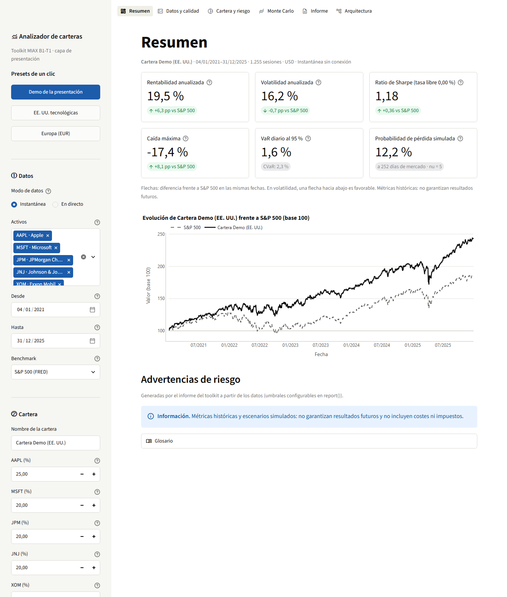
  <br>
  <sub>Demo portfolio (AAPL, MSFT, JPM, JNJ and XOM, 2021-2025) against the S&amp;P 500 from FRED, in the dashboard
  and with real data stored in the repository. The metrics and the simulation come from the toolkit.</sub>
</p>

## Why

Quick scripts that download prices and compute four metrics stop being useful as soon as you have to combine
providers, mix stocks with indices or macroeconomic indicators, or repeat the analysis with another portfolio.
portfolio-risk-toolkit solves that with a **common data contract**: every source returns the same kind of object,
and the portfolio, the cleaning step, the simulation engine and the reports depend only on that contract. Adding a
provider means writing an adapter; the rest of the system stays the same.

## Features

- **Four sources, one output.** Yahoo Finance, the World Bank, FRED and the ECB return `SeriePrecios` or
  `SerieIndicador` with the same attributes (`valores`, `fuente`, `frecuencia`, `unidad`), and `descargar_series`
  downloads lists of assets in batch.
- **Self-validating DataClasses.** Series and portfolios check their data on creation; price series compute their
  mean and standard deviation automatically.
- **Explicit cleaning.** Normalises dates and values, drops invalid data and aligns different trading calendars
  without filling holidays, with a report of what was dropped.
- **Fat-tailed Monte Carlo.** Correlated multivariate Student's t shocks, configurable (scenarios, horizon, return,
  volatility, degrees of freedom, seed) and applicable to a single asset or to the portfolio.
- **Markdown reports and charts.** `report()` with metrics, diagnostics and risk warnings, and `plots_report()` with
  performance, correlation, growth and risk.
- **Optional dashboard.** A Streamlit app that uses only the public API, works without Internet from a snapshot of
  real data and does not touch the core.
- **Reproducible and tested.** Fixed seeds, pinned dependency versions and tests that need no network.

## Quick start

You need Python 3.12 and Git. Dependency versions are pinned in [`pyproject.toml`](pyproject.toml).

```powershell
git clone https://github.com/raaauulg/portfolio-risk-toolkit.git
cd portfolio-risk-toolkit
py -3.12 -m venv .venv
.\.venv\Scripts\python.exe -m pip install .
.\.venv\Scripts\python.exe ejemplos/demo_completa.py
```

On macOS or Linux, create the environment with `python3.12 -m venv .venv`; the interpreter is `.venv/bin/python`.
There is no need to activate the environment.

The demo uses synthetic data with a fixed seed, so it needs no connection and its output is always the same:

```text
ACC_A: media de precios=121.54, desviación de precios=29.09
ACC_B: media de precios=106.03, desviación de precios=12.37
BONO_C: media de precios=110.65, desviación de precios=4.49
Cartera sintética, a 252 días de mercado, partiendo de 100.00:
- Percentil 5 del valor final (P5): 78.06.
- Mediana del valor final (P50): 106.77.
- Percentil 95 del valor final (P95): 154.46.
...
Informe y cinco gráficos guardados en ...\portfolio-risk-toolkit\resultados\demo
```

To open the dashboard:

```powershell
.\.venv\Scripts\python.exe -m pip install -e ".[app]"
.\.venv\Scripts\python.exe -m streamlit run app/dashboard.py
```

It opens at <http://localhost:8501>; <http://localhost:8501/?preset=demo> starts with the demo portfolio already
computed.

| Extra | Install | Purpose |
| --- | --- | --- |
| — | `pip install .` | The toolkit. |
| `dev` | `pip install -e ".[dev]"` | Tests with pytest. |
| `app` | `pip install -e ".[app]"` | Dashboard (Streamlit and Plotly). |

## Library usage

```python
from miax_toolkit import Cartera, descargar_series, descargar_sp500_fred

datos = descargar_series(["AAPL", "MSFT"], "2025-01-01", "2026-01-01")
cartera = Cartera("Acciones USA", list(datos.values()), {"AAPL": 0.6, "MSFT": 0.4})
referencia = descargar_sp500_fred("2025-01-01", "2026-01-01")

resultado = cartera.monte_carlo(n_sims=2000, horizonte=252, retorno=0.06, volatilidad=None,
                                nu=5, v0=100.0, semilla=42)
print(resultado.interpretacion())
resultado.plot()

print(cartera.report(simulacion=resultado, benchmark=referencia.valores))
cartera.plots_report(benchmark=referencia.valores)

# A single asset starts from its last price unless v0 is given.
individual = datos["AAPL"].monte_carlo(n_sims=1000, horizonte=126)
```

With the demo portfolio (calibrated on 2021-2025, 5,000 scenarios over 252 sessions and `nu = 5`),
`resultado.plot()` draws the fan of paths and the distribution of the final value:

<p align="center">
  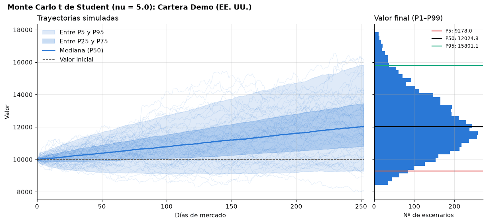
</p>

`report()` returns Markdown ready to save or publish. A real excerpt for the same portfolio against the S&P 500:

```markdown
# Informe de Cartera Demo (EE. UU.)

Periodo: 04/01/2021 a 31/12/2025 (1255 sesiones). Cartera de comprar y mantener.

| Métrica | Valor |
| --- | --- |
| Rentabilidad anualizada | 19,46 % |
| Volatilidad anualizada | 16,21 % |
| Ratio de Sharpe (tasa libre 0,00 %) | 1,18 |
| Caída máxima | -17,37 % |
| VaR diario histórico al 95 % | 1,61 % |
| CVaR diario histórico al 95 % | 2,29 % |
| Beta frente a ^GSPC | 0,83 |
```

And `plots_report()` returns the analytical charts as a dictionary of Matplotlib figures:

| Growth and drawdowns | Return correlation |
| :---: | :---: |
| 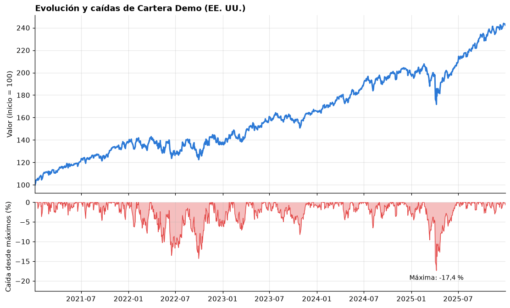 | 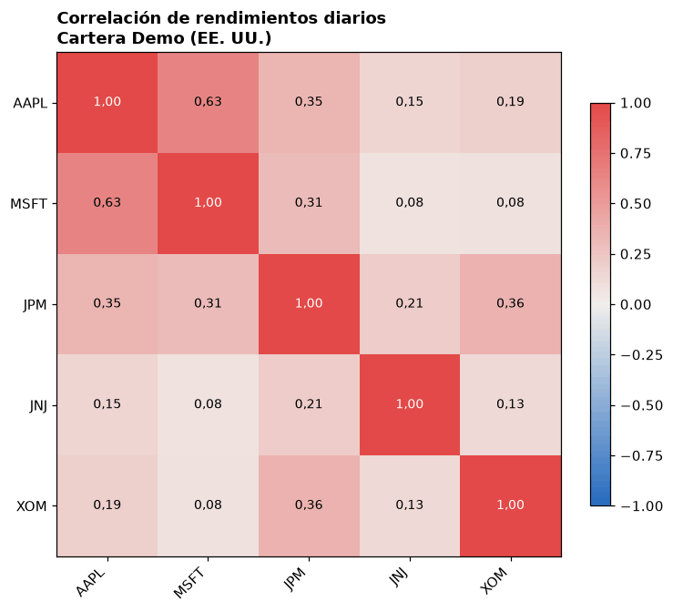 |

<p align="center">
  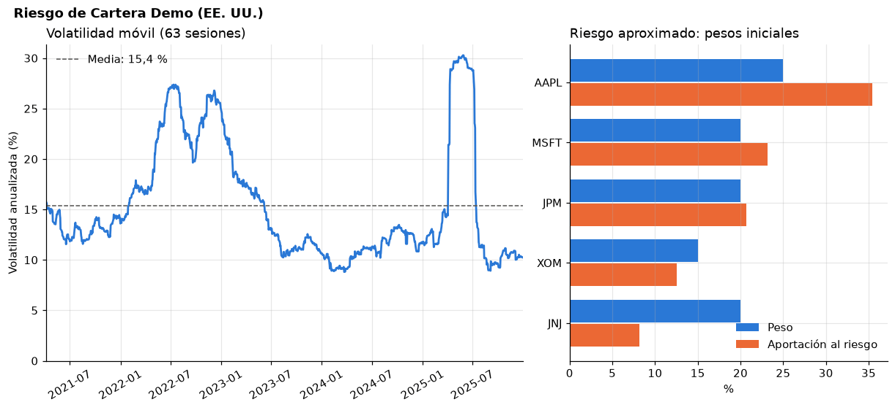
</p>

The scripts in [`ejemplos/`](ejemplos) walk through the whole toolkit:

| Script | What it shows | Network |
| --- | --- | --- |
| [`demo_completa.py`](ejemplos/demo_completa.py) | DataClasses, statistics, portfolio, cleaning, single-asset and portfolio Monte Carlo, report and charts, with synthetic data. | No |
| [`demo_fuentes.py`](ejemplos/demo_fuentes.py) | The four sources and the full analysis of AAPL and MSFT against the S&P 500. | Yes |

Each script writes `informe.md` and five images to `resultados/demo` or `resultados/fuentes` (`--salida` changes
the destination). The results are not versioned.

## Dashboard

**[Open the live demo →](https://portfolio-risk-toolkit.streamlit.app/?preset=demo)**

A Streamlit app to explore the toolkit without writing code. It is just another consumer of the public API, like
the scripts in `ejemplos/`, and it does not modify `src/`; its dependencies are optional and `import miax_toolkit`
does not load Streamlit or Plotly.

- **Two data modes.** *Snapshot*, the default, uses the real 2021-2025 prices stored in
  [`data/sample/`](data/sample) and works without Internet. *Live* downloads from Yahoo Finance and FRED.
- **Three presets.** Five US companies from different sectors against the S&P 500, US tech stocks, and a European
  portfolio in EUR. Each uses a single currency, because the toolkit does not convert currencies.
- **The numbers and the validations are the toolkit's own.** Weights that do not add up to 100 % or a portfolio
  with several currencies show the message of its `ValueError`, and a network failure is told apart from a query
  that returns no data.

<table>
  <tr>
    <td width="50%">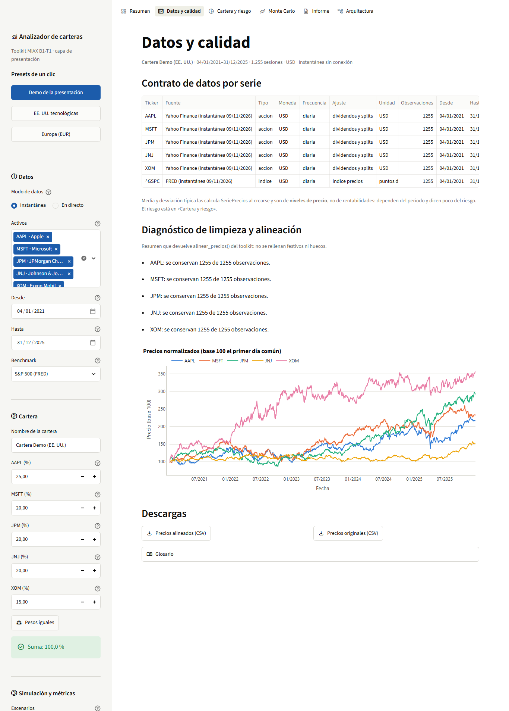</td>
    <td width="50%">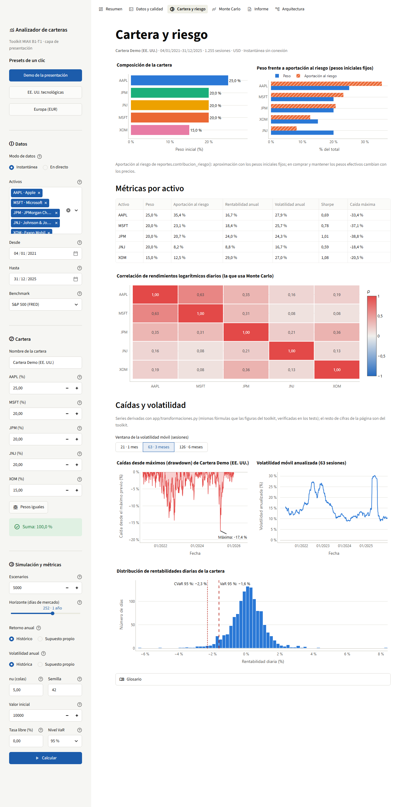</td>
  </tr>
  <tr>
    <td><sub><b>Data and quality.</b> Data contract of each series and the cleaning and alignment report; here, the
    European portfolio with three exchanges and different calendars.</sub></td>
    <td><sub><b>Portfolio and risk.</b> Composition, weight against risk contribution and per-asset metrics.</sub></td>
  </tr>
  <tr>
    <td>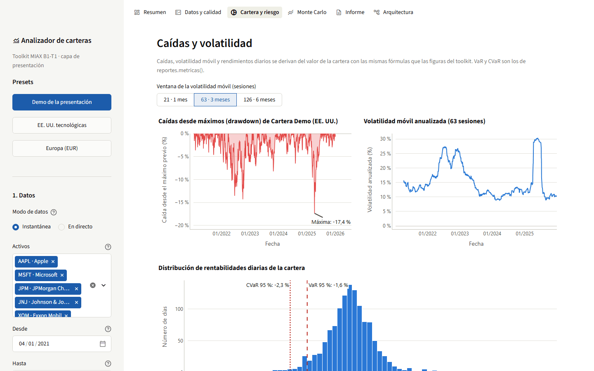</td>
    <td>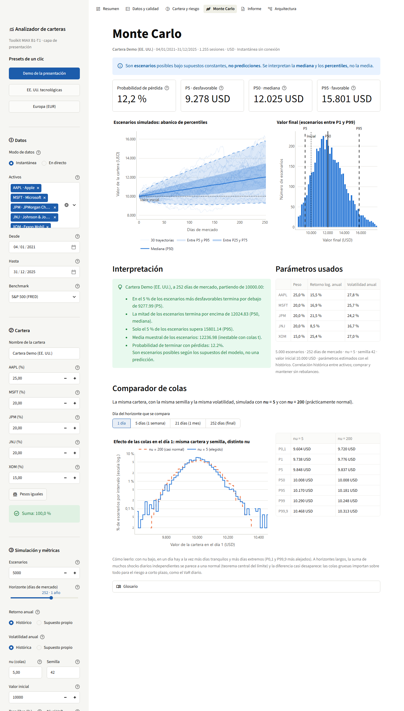</td>
  </tr>
  <tr>
    <td><sub><b>Drawdowns and volatility.</b> Drawdowns from the peak, rolling volatility and daily returns with VaR
    and CVaR.</sub></td>
    <td><sub><b>Monte Carlo.</b> Probability of loss, percentiles, scenario fan and final value.</sub></td>
  </tr>
  <tr>
    <td>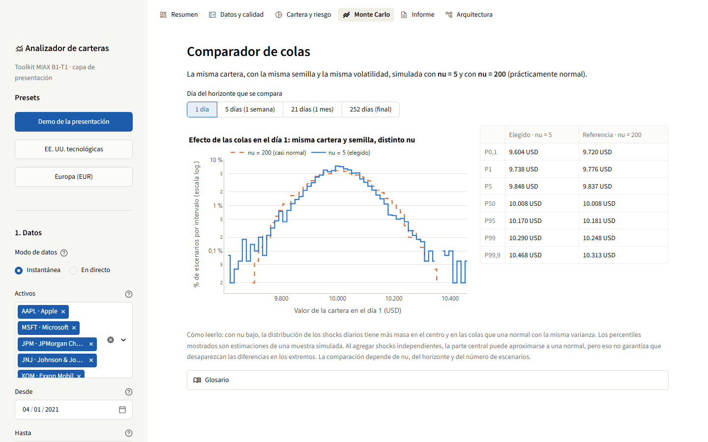</td>
    <td>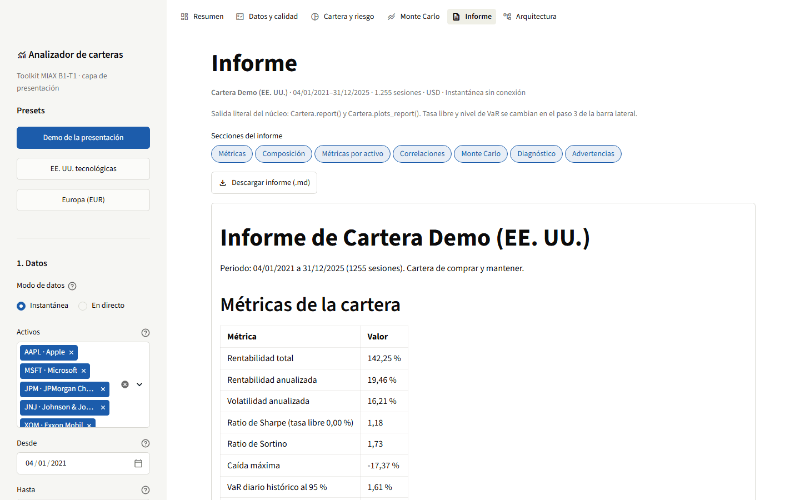</td>
  </tr>
  <tr>
    <td><sub><b>Tail comparison.</b> The same portfolio and seed with <code>nu = 5</code> and with
    <code>nu = 200</code> (nearly normal), day by day.</sub></td>
    <td><sub><b>Report.</b> The unmodified output of <code>report()</code>, downloadable as Markdown, and the
    figures of <code>plots_report()</code>.</sub></td>
  </tr>
  <tr>
    <td>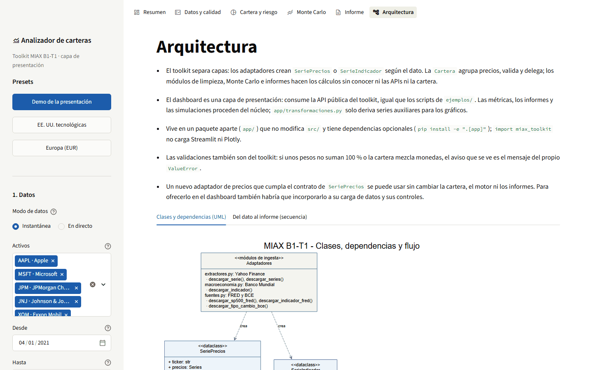</td>
    <td>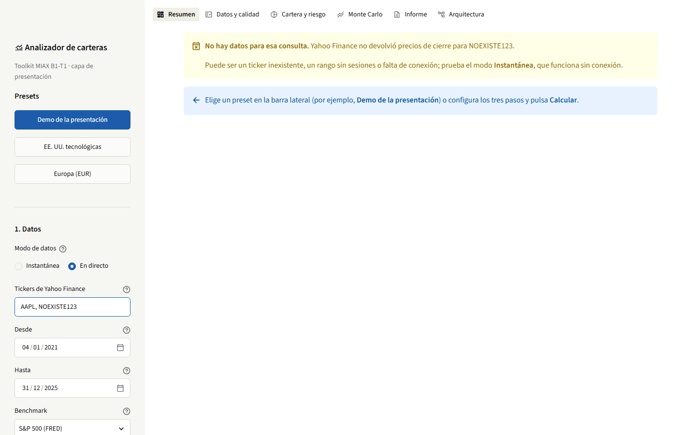</td>
  </tr>
  <tr>
    <td><sub><b>Architecture.</b> Class and sequence diagrams, and the public functions the app uses, generated
    from its imports.</sub></td>
    <td><sub><b>Errors.</b> A non-existent ticker in <i>Live</i> mode produces a no-data warning, different from the
    connection-failure one.</sub></td>
  </tr>
</table>

## Architecture

<p align="center">
  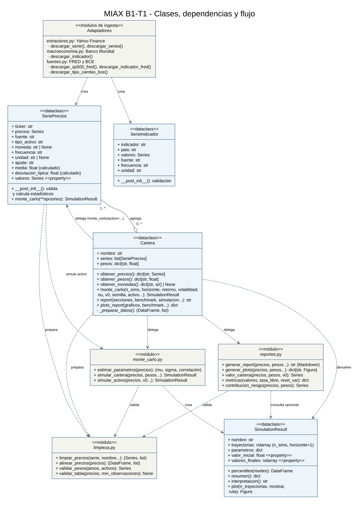
</p>

Dashed arrows mean "uses, creates or delegates to", and the hollow diamond indicates that a `Cartera` aggregates
one or more `SeriePrecios`. [docs/arquitectura.md](docs/arquitectura.md) explains the notation and adds a sequence
diagram of the whole flow, from the download to the report.

| Module | Responsibility |
| --- | --- |
| `extractores.py` | Yahoo Finance and batch download |
| `macroeconomia.py` | `SerieIndicador` and the World Bank |
| `fuentes.py` | FRED and ECB |
| `modelos.py` | `SeriePrecios` |
| `cartera.py` | `Cartera`: validates, prepares the data and delegates the calculations |
| `limpieza.py` | Cleaning, alignment and validation |
| `monte_carlo.py` | Simulation engine and `SimulationResult` |
| `reportes.py` | Markdown report, metrics and charts |
| `app/` | Dashboard (presentation layer, outside the package) |

### Design decisions

- **DataClasses that validate on creation.** `SeriePrecios`, `SerieIndicador`, `Cartera` and `SimulationResult`
  check their requirements in `__post_init__`; the checks specific to the analysis (frequency, currency and clean
  prices) are repeated before each calculation, because the objects are mutable.
- **Composition and delegation instead of inheritance.** `Cartera` aggregates `SeriePrecios`, and `monte_carlo()`,
  `report()` and `plots_report()` prepare the data and delegate to function modules that work with pandas tables and
  know nothing about `Cartera` or the APIs. Each calculation is tested with synthetic data, and the same engine
  serves a single asset and a portfolio.
- **Two independent series classes.** A macroeconomic indicator is not a price and must not end up in a portfolio;
  `Cartera` checks that its assets are `SeriePrecios`.
- **Explicit errors rather than silent fixes.** Anything that breaks the constraints is rejected with a clear
  message. Adapters raise `RuntimeError` on network or provider failures and `ValueError` when there is no data or
  the input is invalid.
- **Multivariate Student's t.** Fatter tails than the normal distribution, with the correlation between assets
  preserved through the Cholesky factor and a single chi-squared draw shared by all assets on each day.

## How it works

### Data sources

| Source | Functions | Output |
| --- | --- | --- |
| Yahoo Finance (`yfinance`) | `descargar_serie`, `descargar_series` | Daily closes of stocks and indices as `SeriePrecios`. |
| World Bank (Indicators API) | `descargar_indicador` | Annual indicators by country as `SerieIndicador`. |
| FRED (public CSV download) | `descargar_sp500_fred`, `descargar_indicador_fred` | S&P 500 as `SeriePrecios`; indicators as `SerieIndicador`. |
| ECB (SDMX API) | `descargar_tipo_cambio_bce` | Daily reference rate, in units of the currency per 1 EUR, as `SerieIndicador`. |

Every output shares `valores` (a numeric `pandas.Series` with a sorted `DatetimeIndex`), `fuente`, `frecuencia`
and `unidad`, and keeps its own metadata: ticker, currency and adjustment for prices; indicator and country or area
for indicators. In `SeriePrecios`, `valores` is a property that returns `precios` without copying them. The same
kind of data returns the same class whatever the provider: the S&P 500 from Yahoo and from FRED are both
`SeriePrecios` with the identifier `^GSPC`.

```python
from miax_toolkit import descargar_indicador, descargar_indicador_fred, descargar_tipo_cambio_bce

pib = descargar_indicador("ESP", "NY.GDP.MKTP.CD", 2020, 2024)
paro = descargar_indicador_fred("UNRATE", "2025-01-01", "2026-01-01",
                                pais="USA", frecuencia="mensual", unidad="%")
eurusd = descargar_tipo_cambio_bce("USD", "2025-01-01", "2025-02-01")
```

<details>
<summary><b>Provider details</b></summary>

- Yahoo downloads closes adjusted for dividends and splits (`auto_adjust=True`). For price indices such as the
  S&P 500 that is not the same as a total return index; the `ajuste` field tells the two apart.
- A currency given at download time takes precedence. Otherwise it is read from Yahoo's metadata and, failing that,
  from `fast_info`. If it is unknown, it stays `None`: the series can be inspected, but the currency has to be filled
  in before using it in a portfolio. Setting a currency does not convert prices.
- `descargar_series` processes the list sequentially, rejects duplicate tickers and stops at the first failure so
  it never returns an incomplete portfolio without warning.
- Yahoo, FRED and the ECB take `YYYY-MM-DD` dates, with an inclusive start and an exclusive end. The World Bank
  takes years with both ends inclusive and dates each annual value on 31 December.
- FRED's CSV does not carry enough metadata, so for its indicators the country, frequency and unit are given from
  the series page. It is the public download, not the keyed API. FRED's S&P 500 covers a rolling ten-year window
  and the period actually available is returned.
- The World Bank labels GDP `NY.GDP.MKTP.CD` as current USD; for other indicators `unidad` can be given and
  otherwise it stays `no especificada`.
- Gaps in indicators are dropped: no interpolation, no change of frequency and no filled observations.
- Live queries use fixed dates, but providers may revise their data. A failed download raises an explicit error:
  real data is never replaced with synthetic data.

</details>

### Portfolio, cleaning and input validation

On creation, `SeriePrecios` computes the mean and the sample standard deviation (`ddof=1`) of the valid prices.
These are statistics of price levels, not of returns; if the series is modified, a new object has to be created to
recompute them.

`Cartera` groups series and weights by ticker. It requires unique assets, one weight per asset and finite,
non-negative weights that add up to one within a `1e-6` tolerance; within that tolerance it normalises them so the
initial capital is invested exactly. The composition is validated again before each analysis in case the assets or
the weights have been edited.

The input is restricted on purpose: the analysis works with positive, finite **daily prices**, with unique dates
and in **a single known currency**. Rejecting ambiguous data is preferred over interpreting it silently.

<details>
<summary><b>Cleaning rules and minimum data</b></summary>

- Intraday, weekly or monthly data is not accepted as if it were daily, and neither are short positions or
  portfolios with several currencies.
- A series can be created with gaps, which are removed during cleaning before the analysis. It needs at least two
  finite values for its statistics.
- `limpiar_precios` takes a `Series`: it normalises the dates, removes `NaT`, sorts, keeps the last record of each
  duplicated date, converts numeric strings with a decimal comma and drops missing, infinite or non-positive values.
  It recognises `YYYY-MM-DD` and `DD-MM-YYYY` dates with `-`, `/` or `.` separators, and removes the time zone while
  keeping the local session date. It warns about frequent gaps and large jumps, but does not correct splits. It
  rejects several different timestamps within one session, because turning intraday data into daily closes is a
  decision for the user. Booleans and complex numbers are not interpreted as prices.
- `alinear_precios` takes a dictionary of series or a DataFrame, keeps only the dates with a valid price for every
  asset, without filling holidays, and returns the table together with a report of what was dropped.
- Reports need at least three common dates. Monte Carlo requires 30 by default; `min_observaciones` lowers it to as
  few as three. This is a design threshold, not a statistical guarantee. Reports warn when there is less than one
  year of history.
- The benchmark is cleaned and matched with the portfolio on actual dates; the report and the historical charts are
  computed over that common period, which must have at least three dates. The benchmark is not filled with past
  prices.
- `simular_cartera` and `simular_activo` take already clean prices without metadata, so the caller must guarantee a
  common currency and daily frequency. The object methods are the recommended entry point.

</details>

### Monte Carlo

| Parameter | Meaning |
| --- | --- |
| `n_sims` | Number of scenarios. |
| `horizonte` | Simulated sessions. |
| `retorno`, `volatilidad` | Annual. `None` estimates them from history; a number sets them for every asset; a dictionary sets them per asset. |
| `nu` | Degrees of freedom of the Student's t (`nu > 2`). |
| `v0` | Initial capital. |
| `semilla` | Reproducibility. |

The model uses daily log returns `r = retorno/252 + volatilidad/sqrt(252) · Z`, with standardised multivariate t
shocks (zero mean, unit variance), and applies `P(t+1) = P(t) · exp(r)`. `retorno` is therefore a log return, not
an expected simple return. The correlation is estimated from history and the shocks are generated correlated. The
portfolio is buy-and-hold: initial weights and no rebalancing.

`SimulationResult` includes the paths, P5/P50/P95, the sample mean and the probability of ending below the initial
capital, as well as the calibration period. With exponentiated t shocks the theoretical expectation of the price is
not finite, so **the median and the percentiles are what you read, not the mean**. These are scenarios with
constant parameters, not forecasts.

<details>
<summary><b>Special cases of the model</b></summary>

- Every parameter must be finite; invalid numeric values are rejected explicitly.
- A matrix with perfect correlations is accepted through its spectral decomposition.
- A constant asset keeps zero historical volatility. If a positive volatility is imposed on it, zero correlation
  with the others is used because history cannot estimate it; even so it is not independent, since all shocks share
  the chi-squared factor of the multivariate t.
- The histogram is clipped to P1–P99 for readability (if clipping would leave it empty, it shows every scenario and
  says so in the title); percentiles and summaries always use every scenario.
- With little history, the return estimate is unstable. Costs, taxes, rebalancing and future changes in volatility
  or correlation are not modelled.

</details>

### Reports and charts

`cartera.report()` returns Markdown and accepts `secciones`, an annual `tasa_libre`, `nivel_var`, `benchmark`,
`simulacion`, `umbrales` and `ruta` to save the text. The available sections are `resumen`, `composicion`,
`activos`, `correlaciones`, `montecarlo`, `diagnostico` and `advertencias`:

```python
texto = cartera.report(secciones=("resumen", "advertencias"), nivel_var=0.99)
```

It includes total and annualised return, volatility, Sharpe, Sortino, maximum drawdown, historical VaR and CVaR
and, when there is a benchmark with enough variation, beta. VaR and CVaR are expressed as daily losses. Metrics that
cannot be estimated show as `n/d`, and the warning thresholds are configurable.

`cartera.plots_report()` lets you choose `graficos` (`rendimiento`, `correlacion`, `evolucion`, `riesgo`) and set
`ventana_volatilidad`, `benchmark`, `mostrar` and `carpeta`.

<details>
<summary><b>Metric conventions</b></summary>

- Annualisation assumes 252 observations per year. After alignment, a return may span more than one session; the
  toolkit does not rebuild that calendar, so with many gaps the annualisation is only approximate.
- VaR and CVaR can be negative if even the worst returns were positive.
- Risk contribution is computed with fixed initial weights, which do not match the actual drift of weights in
  buy-and-hold.
- The historical valuation is rebased to 100.
- A simulation included in the report keeps its capital, assumptions and calibration period, which the report shows
  separately; adding a benchmark does not recalibrate it.
- If there are not enough sessions for the volatility window, no observations are made up.

</details>

### Adding a data source

All it takes is an adapter that meets the contract; the portfolio, the cleaning, the engine and the reports stay
the same.

1. Write the download function in an ingestion module, for example `fuentes.py`, which already provides
   `_intervalo`, `_csv` and `_normalizar`. It must raise `RuntimeError` if the network fails and `ValueError` if the
   data is invalid.
2. Normalise the response to the contract: a `float` `Series` with a time-zone-naive date index, sorted and without
   duplicates.
3. Return `SeriePrecios` for prices (with `moneda` and `ajuste`) or `SerieIndicador` otherwise.
4. Export it in `src/miax_toolkit/__init__.py` and in `__all__`.
5. Test it without Internet, mocking the network call with `unittest.mock.patch`.

```python
# src/miax_toolkit/fuentes.py (the URL is made up)
def descargar_precios_mi_proveedor(ticker: str, inicio: str, fin: str, moneda: str) -> SeriePrecios:
    """Daily closes from Mi Proveedor normalised to the common contract."""
    primero, ultimo = _intervalo(inicio, fin)
    tabla = _csv("https://proveedor.example/precios.csv", {"s": ticker}, "Mi Proveedor")
    precios = _normalizar(tabla, "Date", "Close", primero, ultimo, ticker.upper())
    return SeriePrecios(ticker.upper(), precios, "Mi Proveedor", moneda=moneda, ajuste="no_especificado")
```

From then on, the series is used exactly like one from Yahoo:
`Cartera("Mixta", [serie_yahoo, serie_nueva], pesos).report()`.

## Testing

```powershell
.\.venv\Scripts\python.exe -m pip install -e ".[dev,app]"
.\.venv\Scripts\python.exe -W error -m pytest -q
```

[Continuous integration](.github/workflows/ci.yml) runs them on every push and pull request, on Ubuntu and
Windows, together with the offline demo and an install of the core without the dashboard dependencies.

The tests need no Internet: calls to Yahoo, the World Bank, FRED and the ECB are mocked with `unittest.mock` and
everything else uses synthetic data with a fixed seed. Among other things, they check that every source meets the
same contract, that the portfolio validates weights, currency and frequency, that the simulation is reproducible and
that the median of `log(final value)` matches `log(v0) + retorno · years`. The dashboard tests (`tests/app/`, with
`streamlit.testing.v1.AppTest`) run the three presets offline, check the query, weight and currency errors, and
verify that the numbers shown match those of the toolkit's report; they are skipped if the `app` extra is not
installed.

## Limitations

- Currencies are not converted: a portfolio with several currencies is rejected.
- Annualisation assumes 252 sessions per year and is approximate if the history has many gaps.
- Monte Carlo uses constant parameters and does not model costs, taxes or rebalancing.
- `descargar_series` downloads sequentially and stops at the first failure: it neither parallelises nor returns
  partial results.
- The common series contract is a convention and the adapters are functions, not a `typing.Protocol` or an abstract
  class. With four sources that is enough; with more it would be worth formalising.
- The dashboard derives in `app/transformaciones.py` three series that the public API does not expose (drawdowns,
  rolling volatility and daily returns), with tests that check they match the toolkit's figures.
- The snapshot assets were chosen in hindsight among today's large companies (survivorship bias), so their
  historical returns are optimistic.

## Roadmap

**Dashboard as a self-hosted service.** The [public demo](https://portfolio-risk-toolkit.streamlit.app/?preset=demo)
is served from Streamlit Community Cloud, which installs the project from `requirements.txt`. For a service with
full control over resources and access:

1. **Container.** A `Dockerfile` with Python 3.12 that installs `.[app]` and starts Streamlit with
   `--server.address 0.0.0.0 --server.headless true`, with a `HEALTHCHECK` on `/_stcore/health`. The snapshot ships
   inside the image, so the service does not depend on Yahoo or FRED to start.
2. **Server.** A small virtual machine (Azure, AWS or GCP) running the container with automatic restart
   (`--restart unless-stopped` or systemd), or a managed service such as Azure Container Apps or Google Cloud Run.
3. **Access.** A reverse proxy (nginx or Caddy) with HTTPS and, if data with restrictive terms of use is published,
   authentication.
4. **Fresh data.** A scheduled job (cron or GitHub Actions) that runs `python -m app.generar_instantanea`, passes the
   tests and publishes the new snapshot, plus a persistent download cache in Parquet or SQLite.
5. **Multiple users.** Per-session memory and scenario limits, and large simulations in a separate process.

**Toolkit.**

- Static analysis (`ruff` and `mypy`) in continuous integration, which today runs the tests on Ubuntu and Windows.
- A formal adapter contract with `typing.Protocol` or an abstract class.
- Public functions in `reportes` for drawdowns, rolling volatility, beta and warnings as data, so the dashboard no
  longer needs `app/transformaciones.py`.
- Parallel downloads with retries and exponential backoff, and new sources (Alpha Vantage, Finnhub, fundamentals).
- Multi-currency portfolios using the exchange rate from `descargar_tipo_cambio_bce`.
- Periodic rebalancing and transaction costs.
- Time-varying volatility (GARCH), dynamic correlations and historical *bootstrap* as alternatives to the Student's t.
- *Walk-forward* backtesting and weight optimisation (minimum variance, risk parity).
- In the dashboard: comparison of several portfolios, PDF export of the report and a review of the dark theme.

## Documentation

These documents are in Spanish.

| Document | Contents |
| --- | --- |
| [Architecture](docs/arquitectura.md) | UML notation, separation of responsibilities and sequence diagram |
| [Snapshot data](data/sample/README.md) | Sources, download date, format, adjustment, survivorship bias and terms of use |
| [Examples](ejemplos) | Reproducible scripts for the whole toolkit and the four sources |

<details>
<summary><b>Mapping to the workshop brief</b></summary>

| Section | Where it is |
| --- | --- |
| 4.1 Repository and setup | This README, `src/`, `pyproject.toml`, `.gitignore` |
| 4.2 Multi-source ingestion | `extractores.py`, `macroeconomia.py`, `fuentes.py`; batch download with `descargar_series` |
| 4.3 Price series and portfolio | `modelos.py`, `cartera.py` |
| 4.4 Monte Carlo | `monte_carlo.py`, `Cartera.monte_carlo()`, `SimulationResult.plot()` |
| 4.5 Cleaning, validation and reports | `limpieza.py`, `reportes.py`, `Cartera.report()`, `Cartera.plots_report()` |
| 4.6 Diagrams | `docs/arquitectura.md`, `docs/arquitectura.svg`, `docs/secuencia.svg` |

</details>

<details>
<summary><b>References</b></summary>

- [yfinance: historical data](https://ranaroussi.github.io/yfinance/reference/api/yfinance.Ticker.history.html).
- [World Bank: Indicators API](https://datahelpdesk.worldbank.org/knowledgebase/articles/889392-about-the-indicators-api-documentation).
- [FRED: downloading data](https://fred.stlouisfed.org/help/data/downloading/using-the-download-data-link/),
  [UNRATE series](https://fred.stlouisfed.org/series/UNRATE) and [SP500 series](https://fred.stlouisfed.org/series/SP500).
- [ECB: SDMX API examples](https://data.ecb.europa.eu/help/api/data-examples).
- [Multivariate t distribution](https://docs.scipy.org/doc/scipy/reference/generated/scipy.stats.multivariate_t.html)
  (mathematical reference; the engine is implemented with NumPy and does not require SciPy).

</details>

## License

The code is released under the [MIT License](LICENSE): it can be used, modified and redistributed freely, including
for commercial purposes, as long as the copyright notice is kept.

The data in [`data/sample/`](data/sample) is not covered by that license: it comes from Yahoo Finance and FRED and
keeps the terms of use of its providers (the S&P 500 is the property of S&P Dow Jones Indices), described in
[its README](data/sample/README.md).

portfolio-risk-toolkit is an academic analysis tool: its results are historical or simulated and nothing in it is
financial advice.

## Authors

Javier Hernández Olba · Raúl Gómez Amat · Amalia Lobo Barce

B1-T1 workshop of the MIAX master's programme, Instituto BME, 2026.
