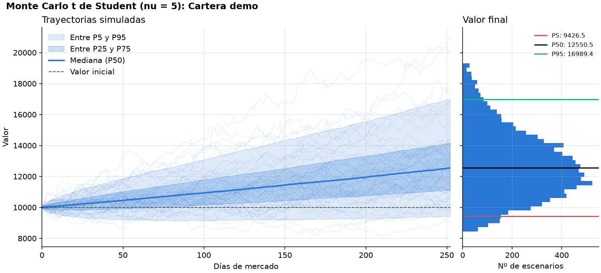

# MIAX — Taller B1-T1

Proyecto académico en Python para la extracción de información bursátil, el
modelado de series de precios y la gestión de carteras de inversión.

## Requisitos

- Python 3.12 o superior.
- Git, y conexión a Internet para instalar dependencias o consultar las APIs.
- Acceso al repositorio privado de GitHub.

## Instalación en Windows

Abrir una terminal en la carpeta donde se quiera descargar el proyecto:

```powershell
git clone https://github.com/JaviHdezOlba/miax-b1-t1.git
cd miax-b1-t1
git fetch origin
git switch feat/bloques-4-1-4-3
python -m venv .venv
.\.venv\Scripts\python.exe -m pip install -e ".[dev]"
```

Si el repositorio ya está clonado, **no repetir** `git clone`. Antes de cambiar
de rama, guardar los cambios locales pendientes. Después, desde la carpeta
del proyecto:

```powershell
git fetch origin
git switch feat/bloques-4-1-4-3
git pull --ff-only origin feat/bloques-4-1-4-3
.\.venv\Scripts\python.exe -m pip install -e ".[dev]"
.\.venv\Scripts\python.exe -m pip check
```

La reinstalación actualiza las dependencias declaradas, también cuando el
paquete ya está instalado en modo editable. Esta rama utiliza
`pandas==3.1.0` y `yfinance==1.8.0`.

## Ejecutar las pruebas

```powershell
.\.venv\Scripts\python.exe -m pytest -q
```

Las pruebas automatizadas simulan respuestas de las APIs, por lo que no
requieren Internet una vez instaladas las dependencias.

## Demostración sin conexión

```powershell
.\.venv\Scripts\python.exe ejemplos/demo_basica.py
```

El ejemplo utiliza precios sintéticos para mostrar las DataClasses y la cartera.

## Demostración completa de los apartados 4.1–4.3

```powershell
.\.venv\Scripts\python.exe ejemplos/demo_bloques_4_1_4_3.py
```

Requiere Internet. Descarga AAPL, MSFT y ^GSPC, consulta el PIB de España,
muestra las series mediante una interfaz común y construye una cartera
de dos acciones con pesos 0.6/0.4. El índice y el PIB se muestran por separado.
La [guía de los bloques 4.1–4.3](docs/guia_bloques_4_1_4_3.md) relaciona cada
requisito con su implementación y explica las decisiones para la presentación.

## Ejemplo con datos reales (requiere conexión)

```python
from miax_toolkit import Cartera, descargar_serie, descargar_series

apple = descargar_serie("AAPL", "2025-01-01", "2026-01-01")
indice = descargar_serie("^GSPC", "2025-01-01", "2026-01-01", tipo_activo="indice")
print(apple.media, apple.desviacion_tipica)

datos = descargar_series(["AAPL", "MSFT"], "2025-01-01", "2026-01-01")
cartera = Cartera("Ejemplo", list(datos.values()), {"AAPL": 0.6, "MSFT": 0.4})
print(cartera.obtener_pesos())
```

La fecha final es exclusiva. Los precios de cierre se descargan ajustados
mediante `auto_adjust=True`.

## Fuentes de datos (apartado 4.2)

- **Yahoo Finance:** acciones, índices y otros instrumentos cotizados. La
  función `descargar_serie()` devuelve un objeto `SeriePrecios`;
  `descargar_series()` procesa una lista de activos de forma secuencial.
- **Banco Mundial:** indicadores macroeconómicos anuales, como el PIB de España.
  La función `descargar_indicador()` devuelve `SerieIndicador`.

```python
from miax_toolkit import descargar_indicador
pib = descargar_indicador("ESP", "NY.GDP.MKTP.CD", 2020, 2024)
print(pib.valores)
```

Ambas fuentes ofrecen la misma interfaz de consulta: `valores` (una
`pandas.Series` numérica con fechas), `fuente` y `frecuencia`. Por ejemplo:

```python
for serie in [apple, pib]:
    print(serie.fuente, serie.frecuencia, serie.valores.head())
```

Los contenedores conservan sus metadatos específicos. En `SeriePrecios`,
`valores` da acceso a los mismos datos que `precios`, sin duplicarlos.

Un indicador macroeconómico no es una serie de precios y no se incluye
directamente en la cartera. La moneda puede indicarse al descargar un activo
o recuperarse, si está disponible, de Yahoo: primero se consultan los metadatos
históricos y después `fast_info["currency"]`. Si ambas consultas fallan o no
devuelven texto válido, queda `None` y se conservan los precios. La moneda
indicada expresamente tiene prioridad. No se convierten divisas.

## Modelado (apartado 4.3)

- `SeriePrecios`: DataClass con ticker, fuente, tipo de activo,
  moneda, frecuencia y precios con índice de fechas. Calcula automáticamente media y
  desviación típica muestral.
- `Cartera`: DataClass que agrupa activos y sus ponderaciones,
  valida la coincidencia de nombres y comprueba que los pesos sumen 1.
  Expone `obtener_precios()`, `obtener_pesos()` y
  `obtener_monedas()` para la futura integración.

## Simulación de Monte Carlo (apartado 4.4)

La simulación es un método directo de la cartera y de cada serie:

```python
from miax_toolkit import Cartera

cartera = Cartera("Mi cartera", series, {"AAPL": 0.6, "MSFT": 0.4})

# Parámetros históricos por defecto; todo es configurable.
resultado = cartera.monte_carlo(
    n_sims=10_000,     # número de escenarios
    horizonte=252,     # días de mercado (252 = un año)
    retorno=None,      # anual, logarítmico. None = histórico; 0.06 = 6 % para todos;
                       # {"AAPL": 0.10} = solo ese activo
    volatilidad=None,  # anual, mismas opciones que retorno
    nu=5,              # grados de libertad de la t de Student (> 2)
    v0=100.0,          # valor inicial de la cartera
    semilla=42,        # reproducibilidad
)
print(resultado.resumen())         # P5, P50, P95, media y probabilidad de pérdida
print(resultado.interpretacion())  # lo mismo, explicado en texto
resultado.plot()                   # trayectorias y distribución del valor final

# Un solo activo: parte de su último precio
resultado_activo = series[0].monte_carlo(horizonte=126, retorno=0.06, volatilidad=0.30)
```

Demostración sin conexión (guarda el gráfico en `docs/img/monte_carlo_cartera.png`):

```powershell
.\.venv\Scripts\python.exe ejemplos/demo_monte_carlo.py
```



**Diseño.** `Cartera.monte_carlo()` es una fachada: limpia y alinea los precios
con `alinear_precios()` (solo fechas en que cotizan todos los activos), exige
al menos `min_observaciones` fechas comunes (30 por defecto) y delega el cálculo
en `simular_cartera()` (módulo `monte_carlo.py`). El resumen de limpieza queda en
`resultado.parametros["limpieza"]`.

**Supuestos del modelo.**

- Rendimientos logarítmicos diarios `r = mu/252 + sigma/sqrt(252) * Z`, con `Z` una
  t de Student multivariante estandarizada (media 0, varianza 1). Las colas son
  más gruesas que en la normal; cuanto menor es `nu`, más gruesas.
- Correlación entre activos: Cholesky de la matriz de correlación histórica y un
  mismo factor chi-cuadrado para todos los activos en cada día, de modo que los
  días extremos lo son a la vez para toda la cartera.
- Comprar y mantener: se invierte `v0` según los pesos el día 0 y no se rebalancea;
  los pesos efectivos derivan con los precios.
- Parámetros constantes durante todo el horizonte, estimados por defecto con el
  histórico (media y desviación típica muestral, `ddof=1`, anualizadas con 252 días).

**Limitaciones.**

- Son escenarios bajo esos supuestos, no predicciones.
- El retorno histórico es muy ruidoso: con dos años de datos, el error típico de
  la media anual es del orden de `sigma / sqrt(2)`. Conviene fijar `retorno` a
  mano con un supuesto razonable.
- Volatilidad y correlación constantes (sin clústeres de volatilidad ni
  correlaciones que suben en las crisis) y colas simétricas.
- Con shocks t de Student el valor esperado teórico del precio no es finito, por
  lo que la media de los escenarios es inestable; la mediana (P50) y los
  percentiles son las medidas fiables.
- No se comprueba que los activos estén en la misma moneda.

## Organización y estado

- `src/miax_toolkit/`: paquete Python.
  - `extractores.py` y `macroeconomia.py`: ingesta (Yahoo Finance y Banco Mundial).
  - `modelos.py` y `cartera.py`: `SeriePrecios` y `Cartera` (apartado 4.3).
  - `limpieza.py`: `limpiar_precios`, `alinear_precios` y `validar_pesos` (apartado 4.5).
  - `monte_carlo.py`: `estimar_parametros`, `simular_cartera`, `simular_activo`
    y `SimulationResult` con su método `plot()` (apartado 4.4).
- `tests/`: pruebas automáticas (`test_integracion_modulos.py` comprueba que
  modelos, limpieza y Monte Carlo encajan entre sí).
- `ejemplos/`: demostración reproducible.
- `docs/fuentes_datos.md`: descripción de fuentes y limitaciones.
- `docs/guia_bloques_4_1_4_3.md`: requisitos, demostración y explicación de esta parte.
- `docs/revision_integracion.md`: comprobación de la interfaz con `monte-carlo`
  y puntos pendientes para una futura integración.

Estado (rama `trabajo-raul`): el motor de Monte Carlo y la limpieza de la rama
`monte-carlo` ya están integrados y se exportan desde `miax_toolkit`, y
`Cartera.monte_carlo()` y `SeriePrecios.monte_carlo()` están disponibles.
Pendiente:

- `report()` y `plots_report()` (apartado 4.5), a cargo de Amalia.
- Diagramas de arquitectura (apartado 4.6).

## Verificación del 5 de noviembre de 2026

En una copia separada de esta rama y un entorno virtual nuevo con Python
3.12.8, pandas 3.1.0 y yfinance 1.8.0:

- Instalación editable correcta y `pip check` sin conflictos.
- 31 pruebas y 17 subcasos correctos con `python -m pytest -q -W error`, incluido
  el contrato multifuente y el rechazo de indicadores en la cartera.
- `ejemplos/demo_basica.py` y `ejemplos/demo_bloques_4_1_4_3.py` correctos.
- Lote real AAPL/MSFT/^GSPC, del 2025-01-01 al 2026-01-01: 250 observaciones
  por activo y moneda USD en los tres.
- Banco Mundial: PIB nominal de España, 2020–2024, con 5 observaciones.
- Sin avisos en esas consultas reales. No se han añadido filtros para ocultarlos.

Los avisos `Pandas4Warning` se reprodujeron con yfinance 1.7.0 y pandas 3.1.0.
yfinance 1.8.0 incorpora la [corrección de las llamadas `inplace`](https://github.com/ranaroussi/yfinance/pull/3020),
por lo que se actualiza únicamente esa dependencia directa y se mantiene pandas.
Estas comprobaciones cubren las funciones utilizadas en el taller, no todas
las funciones de yfinance ni todas las versiones admitidas de Python.
