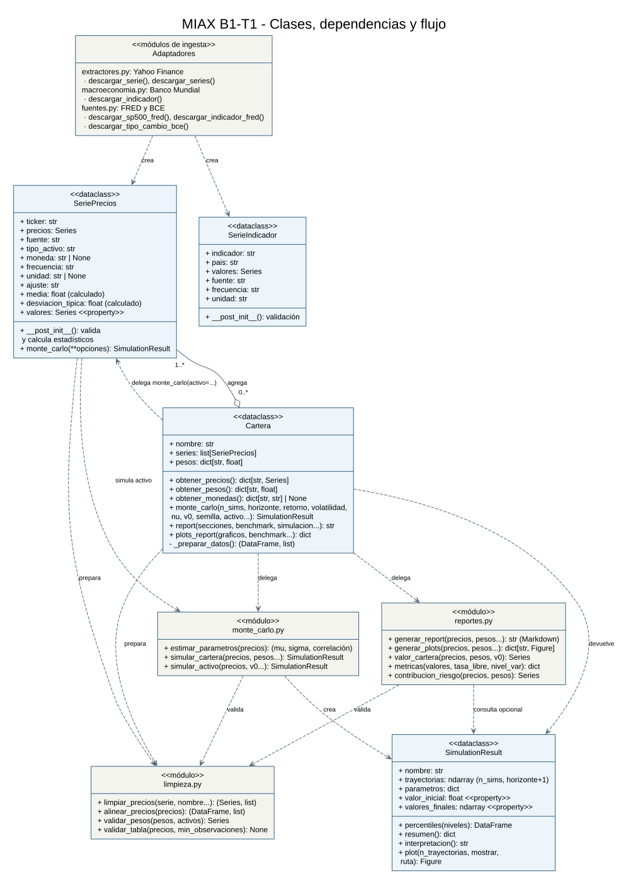
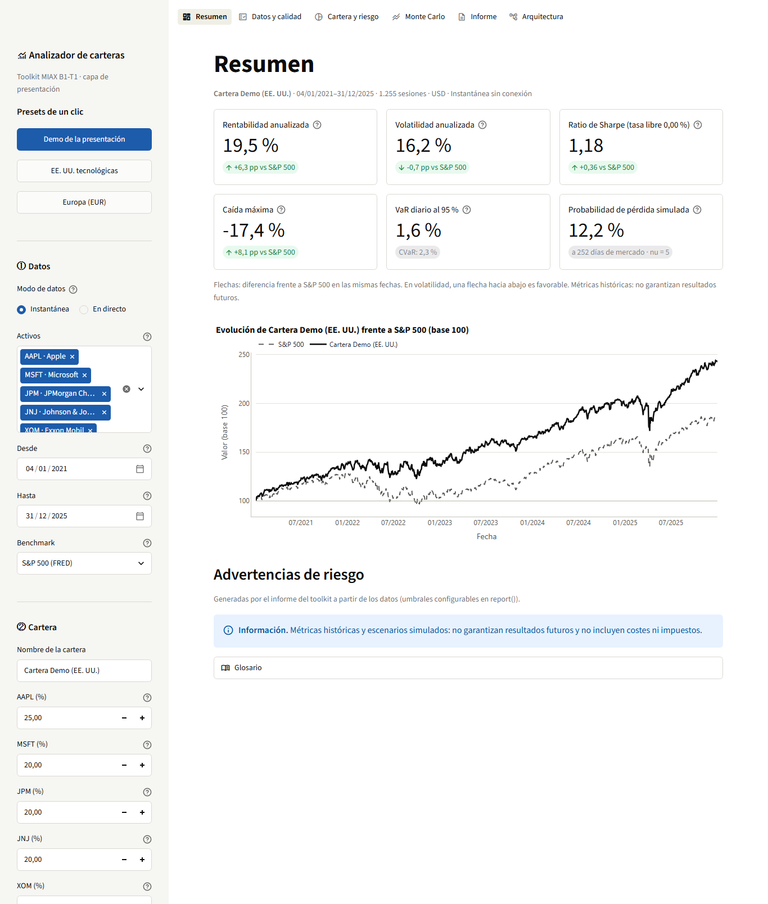
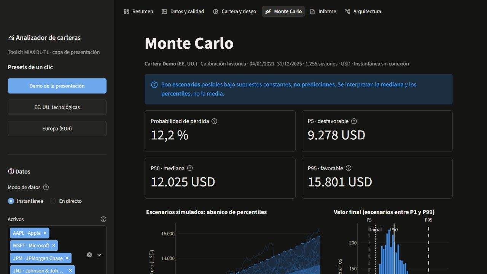

# MIAX — Taller B1-T1

Toolkit en Python para descargar y estandarizar datos financieros, modelar
series y carteras, simular escenarios de Monte Carlo y generar informes.
La ingesta está separada del modelado y del análisis: añadir un proveedor no
requiere cambiar la cartera ni el motor de simulación.

## Instalación

Se necesita **Python 3.12**, Git y acceso a este repositorio privado. Internet
es necesario para instalar las dependencias y ejecutar las consultas reales;
la demostración sintética funciona sin conexión una vez instalado el paquete.
La combinación de dependencias comprobada figura en `pyproject.toml`.

En Windows (PowerShell), desde la carpeta donde se quiera clonar el proyecto:

```powershell
git clone https://github.com/JaviHdezOlba/miax-b1-t1.git
cd miax-b1-t1
py -3.12 -m venv .venv
.\.venv\Scripts\python.exe -m pip install .
.\.venv\Scripts\python.exe -m pip check
.\.venv\Scripts\python.exe ejemplos/demo_completa.py
```

En macOS o Linux, crear el entorno con `python3.12 -m venv .venv` y usar
`.venv/bin/python` en los tres últimos comandos. No hace falta activar el
entorno. Si se modifica el código, reinstalar con `python -m pip install .`
usando el intérprete de ese entorno; para desarrollo se puede instalar con
`python -m pip install -e .`.

## Pruebas

```powershell
.\.venv\Scripts\python.exe -m pip install -e ".[dev]"
.\.venv\Scripts\python.exe -W error -m pytest -q
```

No necesitan Internet: las llamadas a Yahoo, Banco Mundial, FRED y BCE se
simulan con `unittest.mock` y el resto usa datos sintéticos con semilla fija.
Hay un fichero por módulo (`tests/test_extractores.py`, `test_limpieza.py`,
`test_monte_carlo.py`, `test_reportes.py`…). Entre otras cosas comprueban:

- que todas las fuentes devuelven objetos con el mismo contrato de datos;
- que la cartera valida pesos, moneda y frecuencia;
- que la simulación es reproducible con la misma semilla y que la mediana de
  `log(valor final)` de un activo coincide con `log(v0) + retorno · años`;
- que el informe y los gráficos se generan y que los ficheros de texto
  están en UTF-8.

## Ejemplos reproducibles

| Ejemplo | Qué demuestra | Conexión |
| --- | --- | --- |
| `ejemplos/demo_completa.py` | DataClasses, estadísticos, cartera, limpieza, Monte Carlo individual y conjunto, informe y gráficos. Datos sintéticos identificados y semillas fijas. | No |
| `ejemplos/demo_fuentes.py` | Yahoo, Banco Mundial, FRED y BCE; salidas comunes y análisis completo de AAPL/MSFT con S&P 500 como referencia. | Sí |

```powershell
.\.venv\Scripts\python.exe ejemplos/demo_fuentes.py
```

Cada ejemplo escribe `informe.md` y cinco imágenes (simulación, rendimiento,
correlación, evolución y riesgo) en `resultados/demo` o `resultados/fuentes`.
Puede cambiarse la carpeta con `--salida otra_carpeta`. Los resultados
generados no se versionan. Los ejemplos guardan los gráficos sin abrir
ventanas; en uso interactivo, `resultado.plot()` y `cartera.plots_report()`
los muestran por pantalla.

Las fechas de las consultas reales son fijas, pero los proveedores pueden
revisar datos y su disponibilidad depende de la red. Un fallo de descarga
produce un error explícito: nunca se sustituyen datos reales por sintéticos.

## Fuentes y contrato común (4.2)

| Fuente | Funciones | Datos y salida |
| --- | --- | --- |
| Yahoo Finance mediante `yfinance` | `descargar_serie`, `descargar_series` | Cierres diarios de acciones e índices → `SeriePrecios`. |
| Banco Mundial, API de indicadores | `descargar_indicador` | Indicadores anuales por país → `SerieIndicador`. |
| FRED, descarga pública CSV | `descargar_sp500_fred`, `descargar_indicador_fred` | S&P 500 → `SeriePrecios`; indicadores → `SerieIndicador`. |
| BCE, API SDMX | `descargar_tipo_cambio_bce` | Tipo de referencia diario expresado en unidades de una moneda por 1 EUR → `SerieIndicador`. |

Los cuatro proveedores ofrecen `valores` (una `pandas.Series` numérica con
`DatetimeIndex` ordenado), `fuente`, `frecuencia` y `unidad`. Se conservan los
metadatos específicos: ticker, moneda y ajuste en precios; indicador y país
o área en indicadores. `SeriePrecios.valores` es una propiedad que accede a
`precios`, sin duplicarlos.

**Un mismo tipo de dato devuelve la misma clase, independientemente del
proveedor.** Por ejemplo, el S&P 500 de Yahoo y FRED es `SeriePrecios`, con el
identificador interno `^GSPC`. Los indicadores conservan sus unidades y
frecuencias y no se introducen directamente en una cartera de precios.

- Yahoo descarga cierres ajustados por dividendos y splits (`auto_adjust=True`).
  En índices de precios, como S&P 500, no se está descargando un índice de
  rentabilidad total con dividendos. El campo `ajuste` distingue ambos casos.
- La moneda indicada al descargar tiene prioridad. Si no se indica, Yahoo
  intenta obtenerla de sus metadatos y después de `fast_info`. Si no puede
  conocerse, queda `None`: la serie puede consultarse, pero debe completarse
  ese metadato antes de analizar una cartera. Indicar moneda no convierte precios.
- `descargar_series` recibe una lista y procesa un lote secuencial. Rechaza
  tickers repetidos y detiene el lote si falla un activo, sin devolver una
  cartera incompleta inadvertidamente.
- Yahoo, FRED y BCE usan fechas `AAAA-MM-DD`, con inicio inclusivo y fin
  exclusivo. Banco Mundial recibe años y ambos extremos son inclusivos;
  cada dato anual se representa el 31 de diciembre del año correspondiente.
- El CSV de FRED no contiene metadatos suficientes: para indicadores se
  proporcionan explícitamente país, frecuencia y unidad según su ficha.
  Esta descarga pública no es la API FRED con clave. S&P 500 dispone en FRED
  de una ventana móvil de diez años. Se devuelve el periodo realmente disponible.
- Banco Mundial identifica el PIB `NY.GDP.MKTP.CD` como USD corrientes;
  para otros indicadores se puede indicar `unidad`. En ausencia de información
  se conserva `no especificada`, sin inventar unidades.
- Los huecos de datos se omiten al extraer indicadores; no se interpolan,
  convierten frecuencias ni rellenan artificialmente observaciones.

```python
from miax_toolkit import (
    descargar_indicador, descargar_indicador_fred, descargar_tipo_cambio_bce,
)

pib = descargar_indicador("ESP", "NY.GDP.MKTP.CD", 2020, 2024)
paro = descargar_indicador_fred(
    "UNRATE", "2025-01-01", "2026-01-01",
    pais="USA", frecuencia="mensual", unidad="%",
)
eurusd = descargar_tipo_cambio_bce("USD", "2025-01-01", "2025-02-01")
for serie in (pib, paro, eurusd):
    print(serie.fuente, serie.frecuencia, serie.unidad, serie.valores.head())
```

## Modelado y uso de la cartera (4.3–4.5)

`SeriePrecios` es una DataClass que calcula automáticamente la media y la
desviación típica muestral (`ddof=1`) de los precios válidos al instanciarla.
Son estadísticas de **niveles de precios**, no de rentabilidades. Si se cambia
la serie posteriormente, se debe crear un nuevo objeto para recalcularlas.

`Cartera` es una DataClass que agrupa series y pesos por ticker. Comprueba que
los activos sean únicos, que exista exactamente un peso por activo y que los
pesos sean finitos, no negativos y sumen uno (tolerancia `1e-6`).
Dentro de esa tolerancia, los pesos se normalizan para invertir exactamente
el capital inicial. La composición se vuelve a validar antes del análisis
global si se han editado los activos o sus pesos.

Ejemplo completo con precios reales:

```python
from miax_toolkit import Cartera, descargar_series, descargar_sp500_fred

datos = descargar_series(["AAPL", "MSFT"], "2025-01-01", "2026-01-01")
cartera = Cartera("Acciones USA", list(datos.values()), {"AAPL": 0.6, "MSFT": 0.4})
referencia = descargar_sp500_fred("2025-01-01", "2026-01-01")

resultado = cartera.monte_carlo(
    n_sims=2000, horizonte=252, retorno=0.06, volatilidad=None,
    nu=5, v0=100.0, semilla=42,
)
print(resultado.interpretacion())
resultado.plot()
print(cartera.report(simulacion=resultado, benchmark=referencia.valores))
cartera.plots_report(benchmark=referencia.valores)

# Activo individual: parte de su último precio, salvo que se indique v0.
individual = datos["AAPL"].monte_carlo(n_sims=1000, horizonte=126)
# También: cartera.monte_carlo(activo="AAPL", n_sims=1000, horizonte=126).
```

### Inputs admitidos y limpieza

Se elige una entrada restringida para evitar interpretaciones ambiguas:

- El análisis trabaja con **precios diarios** positivos, finitos y fechas
  únicas. No admite datos intradía, semanales o mensuales como si fueran diarios.
- Se pueden construir series de precios con huecos, pero la limpieza elimina
  observaciones inválidas antes de analizar. La serie inicial necesita al
  menos dos valores numéricos finitos para sus estadísticas.
- La cartera analizada requiere moneda conocida e idéntica para todos los
  activos. No se admiten posiciones cortas ni se convierten divisas.
- `limpiar_precios` acepta una `Series`: normaliza fechas, elimina `NaT`,
  ordena, conserva el último registro en fechas duplicadas, convierte textos
  numéricos con coma decimal y elimina valores ausentes, infinitos o no
  positivos. Reconoce fechas `AAAA-MM-DD` y `DD-MM-AAAA` y separadores `/` o `.`.
  Quita la zona horaria conservando la fecha local de la sesión. Avisa de
  huecos abundantes y saltos grandes; no corrige posibles splits automáticamente.
  Rechaza varios instantes distintos de una misma sesión: convertir datos
  intradía en cierres diarios requiere una decisión previa del usuario.
  Los booleanos y los números complejos no se interpretan como precios.
- `alinear_precios` recibe un diccionario de series o un DataFrame. Conserva
  exclusivamente fechas con precio válido para todos los activos, sin rellenar
  festivos. Devuelve la tabla y un diagnóstico de las observaciones descartadas.
- Los informes requieren al menos tres fechas comunes. Monte Carlo exige 30
  por defecto; `min_observaciones` permite cambiarlo, con mínimo de tres.
  Este umbral es una decisión de diseño, no una garantía estadística. Los
  informes avisan cuando hay menos de un año de historia.
- Un benchmark se limpia y se cruza por fechas reales con la cartera; informe
  y gráficos históricos se calculan sobre ese periodo común. Se requieren
  al menos tres fechas coincidentes. No se rellena el benchmark con precios pasados.

Las funciones de cálculo directo `simular_cartera` y `simular_activo` reciben
precios ya limpios. Al no recibir los objetos con metadatos, quien las usa debe
garantizar la moneda común y la frecuencia diaria. Los métodos de los objetos
son la entrada recomendada porque preparan y validan los datos.

### Monte Carlo: parámetros y supuestos

`n_sims` controla los escenarios; `horizonte`, las sesiones; `v0`, el capital
inicial; `semilla`, la reproducibilidad; y `nu > 2`, las colas de la t de Student.
`retorno` y `volatilidad` son anuales: `None` los estima del histórico, un
número los fija para todos los activos y un diccionario cambia activos concretos.
Los parámetros deben ser finitos; los errores numéricos se rechazan expresamente.

El modelo usa rendimientos logarítmicos diarios
`r = retorno/252 + volatilidad/sqrt(252) * Z`, con shocks t multivariantes
estandarizados de media cero y varianza uno. Después aplica `P(t+1)=P(t)*exp(r)`.
El retorno es **logarítmico**, no una rentabilidad simple esperada. Se estima la
correlación histórica y se generan shocks correlacionados. Una matriz con
correlaciones perfectas se admite mediante su descomposición espectral.

Un activo constante conserva volatilidad histórica cero. Si se le impone
volatilidad positiva, se usa correlación cero con los demás: el histórico
constante no permite estimarla. Esto no implica independencia, porque los
shocks comparten el factor chi-cuadrado de la t multivariante. La cartera
sigue **comprar y mantener**, con pesos iniciales y sin rebalanceos.

El resultado incluye trayectorias, P5/P50/P95, media muestral y probabilidad de
terminar por debajo del capital inicial. Con shocks t exponenciados, la
esperanza teórica del precio no es finita: **la media de escenarios es
inestable; se interpretan principalmente mediana y percentiles**. El
histograma recorta a P1–P99 para facilitar su lectura; si el recorte dejara
el gráfico vacío, muestra todos los escenarios. Su título indica qué muestra.
Los percentiles y resúmenes utilizan todos los escenarios. Los parámetros del
resultado conservan las fechas y el número de observaciones de calibración.

Son escenarios bajo parámetros constantes, no predicciones. La estimación de
retornos con poca historia es inestable. No se modelan costes, impuestos,
rebalanceos ni variaciones futuras de volatilidad o correlación.

### Informes y gráficos

`cartera.report()` devuelve Markdown. Admite `secciones`, `tasa_libre` anual,
`nivel_var`, `benchmark`, `simulacion`, `umbrales` y `ruta` para guardar el texto.
Secciones: `resumen`, `composicion`, `activos`, `correlaciones`, `montecarlo`,
`diagnostico` y `advertencias`. Por ejemplo:

```python
texto = cartera.report(secciones=("resumen", "advertencias"), nivel_var=0.99)
```

Incluye rentabilidad total y anualizada, volatilidad, Sharpe, Sortino, caída
máxima, VaR/CVaR históricos y beta si hay referencia con variación suficiente.
VaR/CVaR se expresan como pérdidas diarias: pueden ser negativos si incluso
los peores rendimientos históricos fueron positivos. Las métricas no
estimables aparecen como `n/d`. Los umbrales de advertencia son configurables,
no reglas universales de inversión.

La anualización supone **252 observaciones diarias por año**. Tras la alineación,
un hueco puede hacer que un rendimiento abarque más de una sesión: el toolkit
no reconstruye ese calendario y la anualización es una aproximación. Una
historia con muchos huecos debe revisarse antes de interpretar las métricas.

La aportación al riesgo es una **aproximación con los pesos iniciales fijos**,
distinta de la evolución de los pesos en comprar y mantener. La valoración
histórica parte de base 100. Una simulación incluida en el informe mantiene
su capital, supuestos y periodo de calibración; añadir un benchmark al informe
no recalibra esa simulación. El informe muestra ese periodo por separado y
conserva también el diagnóstico de limpieza del benchmark.

`cartera.plots_report()` permite seleccionar `graficos` entre `rendimiento`,
`correlacion`, `evolucion` y `riesgo`; configurar `ventana_volatilidad`,
`benchmark`, `mostrar` y `carpeta`. Devuelve un diccionario de figuras de
Matplotlib. La ventana de volatilidad necesita suficientes sesiones; si no
las hay, no se inventan observaciones para completarla.

## Estructura y arquitectura (4.1 y 4.6)

```text
src/miax_toolkit/
    __init__.py        API pública
    extractores.py     Yahoo Finance y descarga por lotes
    macroeconomia.py   SerieIndicador y Banco Mundial
    fuentes.py         FRED y BCE
    modelos.py         SeriePrecios
    cartera.py         Cartera y métodos de análisis
    limpieza.py        Limpieza, alineación y validación
    monte_carlo.py     Motor y SimulationResult
    reportes.py        Markdown y gráficos analíticos
ejemplos/
    demo_completa.py
    demo_fuentes.py
docs/
    arquitectura.md
    arquitectura.dot
    arquitectura.svg
    secuencia.svg      Diagrama de secuencia renderizado
app/                   Dashboard opcional (capa de presentación, no forma parte del paquete)
data/sample/           Instantánea de datos reales para el dashboard sin conexión
```

El diagrama UML muestra las clases, los módulos y sus dependencias. Las flechas
discontinuas significan «usa, crea o delega en» y el rombo vacío, que una
`Cartera` agrega una o más `SeriePrecios`:



En [docs/arquitectura.md](docs/arquitectura.md) están la leyenda de la
notación, la separación de responsabilidades y un **diagrama de secuencia** del
flujo completo: descarga → `SeriePrecios` → `Cartera` → limpieza → Monte Carlo
→ informe y gráficos. Los ejemplos de este README y de `ejemplos/` permiten
reproducir los seis bloques del taller.

## Decisiones de diseño

**DataClasses que se validan al crearse.** `SeriePrecios`, `SerieIndicador`,
`Cartera` y `SimulationResult` son `@dataclass`. Su `__post_init__` comprueba los
requisitos de cada objeto. Los controles necesarios para analizar una cartera
(frecuencia, moneda y precios limpios) se aplican antes de cada análisis.
Los objetos son mutables: cambiar sus atributos no vuelve a ejecutar
`__post_init__`; la cartera sí revalida su composición al analizarla.
`SeriePrecios` calcula además la media y la desviación típica
al instanciarse, como pide el apartado 4.3.

**Composición y delegación en lugar de herencia.** `Cartera` *agrega* objetos
`SeriePrecios` y sus métodos `monte_carlo()`, `report()` y `plots_report()` son
fachadas: preparan los datos (`_preparar_datos()`) y delegan el cálculo en
módulos de funciones (`limpieza`, `monte_carlo`, `reportes`) que trabajan con
tablas de pandas y no conocen `Cartera` ni las APIs. Así:

- cada cálculo se puede probar con datos sintéticos sin construir objetos;
- el mismo motor sirve para un activo y para la cartera;
- se puede cambiar un cálculo (por ejemplo, el modelo de simulación) sin tocar
  las clases de datos.

Se eligieron dos clases independientes para mantener sencillo el diseño:
un indicador macroeconómico no es un precio y no debe entrar directamente en
una cartera. Aunque sería posible una base común para series temporales,
no resulta necesaria para compartir los atributos del contrato. `Cartera`
comprueba expresamente que todos sus activos sean objetos `SeriePrecios`.

**Contrato de datos común.** Cualquier adaptador entrega una `pandas.Series` de
`float` con `DatetimeIndex` sin zona horaria, ordenado y sin fechas duplicadas,
dentro de un objeto con `valores`, `fuente`, `frecuencia` y `unidad` (y, en
precios, `ticker`, `moneda` y `ajuste`). El resto del sistema solo depende de
ese contrato, nunca de la respuesta original de cada API.

**Inputs restringidos y errores explícitos.** Se prefiere rechazar con un
mensaje claro antes que corregir en silencio: precios diarios, moneda común,
pesos no negativos que suman uno y un mínimo de observaciones (véase
[Inputs admitidos y limpieza](#inputs-admitidos-y-limpieza)).

**Monte Carlo con t de Student multivariante.** Colas más gruesas que la normal
y correlación entre activos (factor de Cholesky y un mismo chi-cuadrado para
todos los activos cada día). Como la esperanza del precio no es finita con
esos shocks, se interpretan la mediana y los percentiles (véase
[Monte Carlo: parámetros y supuestos](#monte-carlo-parámetros-y-supuestos)).

**Limitaciones conocidas del diseño.**

- La interfaz común de `SeriePrecios` y `SerieIndicador` es una convención que
  no se declara mediante un tipo común; las DataClasses validan sus datos y las
  pruebas comprueban el contrato de los adaptadores. Un `typing.Protocol`
  permitiría además comprobarlo con herramientas de análisis estático.
- Los adaptadores son funciones, no clases con una interfaz abstracta común
  (`ABC`). Con cuatro fuentes es suficiente, pero un contrato formal ayudaría
  si el número de proveedores creciera.
- `descargar_series` descarga los tickers uno tras otro y se detiene en el
  primer fallo. No paraleliza las descargas ni devuelve resultados parciales.
- No se convierten divisas: una cartera con monedas distintas se rechaza.

## Cómo añadir una nueva fuente de datos

Para incorporar una fuente de precios basta con escribir un adaptador que
cumpla el contrato: la cartera, la limpieza, el motor y los informes no cambian.
Los indicadores usan la interfaz de consulta común y se mantienen separados
del análisis de carteras.

1. **Escribe una función de descarga** en un módulo de ingesta (por ejemplo,
   en `fuentes.py`, donde ya existen las utilidades `_intervalo`, `_csv` y
   `_normalizar`). Debe validar sus argumentos y lanzar `RuntimeError` si
   falla la red y `ValueError` si los datos no son válidos.
2. **Normaliza la respuesta al contrato de datos**: `Series` de `float`,
   índice de fechas sin zona horaria, ordenado y sin duplicados.
3. **Devuelve el objeto interno adecuado**: `SeriePrecios` si son precios
   (indicando `moneda`, que la cartera exige, y `ajuste`) o `SerieIndicador`
   si es otro tipo de dato.
4. **Expórtala** en `src/miax_toolkit/__init__.py` y en `__all__`.
5. **Pruébala sin Internet**, simulando la llamada de red con
   `unittest.mock.patch` (por ejemplo, sobre `requests.get`).

Esqueleto ilustrativo para un proveedor que sirve un CSV con columnas `Date` y
`Close` (la URL es un ejemplo, no un servicio real):

```python
# En src/miax_toolkit/fuentes.py
def descargar_precios_mi_proveedor(ticker: str, inicio: str, fin: str,
                                   moneda: str) -> SeriePrecios:
    """Cierres diarios de Mi Proveedor normalizados al contrato común."""
    primero, ultimo = _intervalo(inicio, fin)
    tabla = _csv("https://proveedor.example/precios.csv", {"s": ticker}, "Mi Proveedor")
    precios = _normalizar(tabla, "Date", "Close", primero, ultimo, ticker.upper())
    return SeriePrecios(ticker.upper(), precios, "Mi Proveedor",
                        moneda=moneda, ajuste="no_especificado")
```

A partir de ahí, la nueva serie funciona igual que una de Yahoo:
`Cartera("Mixta", [serie_yahoo, serie_nueva], pesos).report()`.

## Dashboard interactivo (opcional)

Una aplicación local con Streamlit para explorar el toolkit sin escribir
código. Es una **capa de presentación más**, como los scripts de `ejemplos/`:
solo consume la API pública (`Cartera`, `report()`, `plots_report()`,
`SimulationResult`, `reportes.metricas`…) y **no modifica ni una línea de
`src/`**. Sus dependencias son opcionales: `import miax_toolkit` no carga
Streamlit ni Plotly.

```powershell
.\.venv\Scripts\python.exe -m pip install -e ".[app]"
.\.venv\Scripts\python.exe -m streamlit run app/dashboard.py
```

Se abre en `http://localhost:8501`. Con `http://localhost:8501/?preset=demo`
arranca con la cartera de demostración ya calculada.

- **Modos de datos.** *Instantánea* (por defecto) usa los datos reales de
  `data/sample/` (2021-2025, descargados con el propio toolkit) y funciona sin
  Internet. *En directo* descarga de Yahoo Finance y FRED con
  `descargar_series` y `descargar_sp500_fred`.
- **Presets de un clic.** *Demo de la presentación* (cinco empresas de distintos sectores de EE. UU.
  frente al S&P 500), *EE. UU. tecnológicas* y *Europa (EUR)*, cada uno en una
  sola moneda, porque el toolkit no convierte divisas.
- **Páginas.** Resumen (KPI frente al benchmark y advertencias del informe),
  Datos y calidad (contrato de datos y diagnóstico de limpieza), Cartera y
  riesgo, Monte Carlo (abanico, valor final y comparador de colas t frente a
  normal), Informe (`report()` y las figuras de `plots_report()` tal cual) y
  Arquitectura.
- **Errores.** Las validaciones son las del toolkit: unos pesos que no suman
  100 % o una cartera que mezcla monedas muestran el mensaje de su
  `ValueError`. Un fallo de red (`RuntimeError`) se distingue de una consulta
  sin datos (`ValueError`) y sugiere el modo sin conexión.

| Resumen | Monte Carlo |
| --- | --- |
|  |  |

Hay más capturas en `docs/img/`. Los tests del dashboard están en
`tests/app/` (con `streamlit.testing.v1.AppTest`) y se omiten si no está
instalado el extra `[app]`. Para ejecutar también estas pruebas:

```powershell
.\.venv\Scripts\python.exe -m pip install -e ".[dev,app]"
.\.venv\Scripts\python.exe -W error -m pytest -q
```

Las pruebas recorren los tres presets sin conexión y comprueban errores de
consulta, pesos, monedas, tickers repetidos y el comparador de colas. Monte Carlo
usa las fechas comunes entre activos; las métricas históricas con benchmark
usan además las fechas disponibles de ese índice. La página de Monte Carlo
muestra el calendario de calibración, que puede ser distinto del histórico
comparado.

**Limitaciones.** Tres series que la API pública no expone (drawdown,
volatilidad móvil y rendimientos diarios) se derivan en
`app/transformaciones.py` con las mismas fórmulas que las figuras del toolkit;
los tests comprueban que coinciden. Los activos de la instantánea se eligieron a posteriori
(sesgo de supervivencia) y su rentabilidad histórica es optimista.

## Referencias

- [yfinance: consulta de históricos](https://ranaroussi.github.io/yfinance/reference/api/yfinance.Ticker.history.html).
- [Banco Mundial: API de indicadores](https://datahelpdesk.worldbank.org/knowledgebase/articles/889392-about-the-indicators-api-documentation).
- [FRED: descarga de datos](https://fred.stlouisfed.org/help/data/downloading/using-the-download-data-link/),
  [ficha de UNRATE](https://fred.stlouisfed.org/series/UNRATE) y
  [ficha de SP500](https://fred.stlouisfed.org/series/SP500).
- [BCE: ejemplos de la API SDMX](https://data.ecb.europa.eu/help/api/data-examples).
- [Distribución t multivariante: definición y matriz semidefinida](https://docs.scipy.org/doc/scipy/reference/generated/scipy.stats.multivariate_t.html)
  (referencia matemática; el motor se implementa con NumPy y no requiere SciPy).
