# miax-toolkit

Toolkit en Python para descargar datos financieros de varias fuentes,
llevarlos a un formato común, analizar carteras, simular escenarios de
Monte Carlo y generar informes. Es el trabajo del taller B1-T1 del máster
MIAX (Instituto BME).

La ingesta, el modelado y el análisis viven en capas separadas: un proveedor
nuevo solo necesita un adaptador que entregue el contrato de datos común; la
cartera, el motor de simulación y los informes no cambian.


## Contenido

- [Funcionalidades](#funcionalidades)
- [Instalación](#instalación)
- [Uso rápido](#uso-rápido)
- [Fuentes de datos](#fuentes-de-datos)
- [Cartera, limpieza y validaciones](#cartera-limpieza-y-validaciones)
- [Monte Carlo](#monte-carlo)
- [Informes y gráficos](#informes-y-gráficos)
- [Dashboard](#dashboard)
- [Arquitectura](#arquitectura)
- [Decisiones de diseño](#decisiones-de-diseño)
- [Cómo añadir una fuente de datos](#cómo-añadir-una-fuente-de-datos)
- [Pruebas](#pruebas)
- [Limitaciones](#limitaciones)
- [Trabajo futuro](#trabajo-futuro)
- [Correspondencia con el enunciado](#correspondencia-con-el-enunciado)
- [Referencias](#referencias)

## Funcionalidades

| Área | Qué ofrece |
| --- | --- |
| Ingesta | Yahoo Finance, Banco Mundial, FRED y BCE, con un contrato de salida común. |
| Modelado | `SeriePrecios`, `SerieIndicador` y `Cartera` como DataClasses que se validan al crearse. |
| Limpieza | Normalización de fechas y valores, eliminación de datos inválidos y alineación de calendarios con diagnóstico. |
| Simulación | Monte Carlo con shocks t de Student multivariantes y correlación entre activos, para un activo o una cartera. |
| Análisis | Rentabilidad, volatilidad, Sharpe, Sortino, caída máxima, VaR/CVaR históricos, beta y aportación al riesgo. |
| Informes | Informe en Markdown por secciones, advertencias configurables y gráficos de Matplotlib. |
| Dashboard | Aplicación Streamlit opcional que consume la API pública y funciona sin conexión. |

## Instalación

Requisitos: Python 3.12, Git y acceso a este repositorio privado. Las versiones
de las dependencias están fijadas en `pyproject.toml`.

```powershell
git clone https://github.com/JaviHdezOlba/miax-b1-t1.git
cd miax-b1-t1
py -3.12 -m venv .venv
.\.venv\Scripts\python.exe -m pip install .
.\.venv\Scripts\python.exe -m pip check
```

En macOS o Linux, el entorno se crea con `python3.12 -m venv .venv` y el
intérprete es `.venv/bin/python`. No hace falta activar el entorno.

| Extra | Instalación | Para qué |
| --- | --- | --- |
| — | `pip install .` | El toolkit. |
| `dev` | `pip install -e ".[dev]"` | Pruebas con pytest. |
| `app` | `pip install -e ".[app]"` | Dashboard (Streamlit y Plotly). |

Para trabajar sobre el código conviene la instalación editable (`-e`); sin
ella hay que reinstalar después de cada cambio.

## Uso rápido

```python
from miax_toolkit import Cartera, descargar_series, descargar_sp500_fred

datos = descargar_series(["AAPL", "MSFT"], "2025-01-01", "2026-01-01")
cartera = Cartera("Acciones USA", list(datos.values()), {"AAPL": 0.6, "MSFT": 0.4})
referencia = descargar_sp500_fred("2025-01-01", "2026-01-01")

resultado = cartera.monte_carlo(
    n_sims=2000, horizonte=252, retorno=0.06, volatilidad=None,
    nu=5, v0=100.0, semilla=42,
)
print(resultado.interpretacion())
resultado.plot()
print(cartera.report(simulacion=resultado, benchmark=referencia.valores))
cartera.plots_report(benchmark=referencia.valores)

# Un activo individual parte de su último precio, salvo que se indique v0.
individual = datos["AAPL"].monte_carlo(n_sims=1000, horizonte=126)
# Equivalente: cartera.monte_carlo(activo="AAPL", n_sims=1000, horizonte=126)
```

### Ejemplos reproducibles

| Script | Qué muestra | Red |
| --- | --- | --- |
| `ejemplos/demo_completa.py` | DataClasses, estadísticos, cartera, limpieza, Monte Carlo individual y conjunto, informe y gráficos, con datos sintéticos y semillas fijas. | No |
| `ejemplos/demo_fuentes.py` | Las cuatro fuentes, sus salidas comunes y el análisis completo de AAPL y MSFT frente al S&P 500. | Sí |

```powershell
.\.venv\Scripts\python.exe ejemplos/demo_completa.py
.\.venv\Scripts\python.exe ejemplos/demo_fuentes.py
```

Cada script escribe `informe.md` y cinco imágenes (simulación, rendimiento,
correlación, evolución y riesgo) en `resultados/demo` o `resultados/fuentes`;
`--salida otra_carpeta` cambia el destino. Los resultados no se versionan. Los
scripts guardan los gráficos sin abrir ventanas; en una sesión interactiva,
`resultado.plot()` y `cartera.plots_report()` los muestran en pantalla.

Las consultas reales usan fechas fijas, pero los proveedores pueden revisar
sus datos y la disponibilidad depende de la red. Un fallo de descarga produce
un error explícito: nunca se sustituyen datos reales por sintéticos.

## Fuentes de datos

| Fuente | Funciones | Salida |
| --- | --- | --- |
| Yahoo Finance (`yfinance`) | `descargar_serie`, `descargar_series` | Cierres diarios de acciones e índices como `SeriePrecios`. |
| Banco Mundial (API de indicadores) | `descargar_indicador` | Indicadores anuales por país como `SerieIndicador`. |
| FRED (descarga pública en CSV) | `descargar_sp500_fred`, `descargar_indicador_fred` | S&P 500 como `SeriePrecios`; indicadores como `SerieIndicador`. |
| BCE (API SDMX) | `descargar_tipo_cambio_bce` | Tipo de referencia diario, en unidades de la moneda por 1 EUR, como `SerieIndicador`. |

Todas las salidas comparten `valores` (una `pandas.Series` numérica con
`DatetimeIndex` ordenado), `fuente`, `frecuencia` y `unidad`, y conservan sus
metadatos propios: ticker, moneda y ajuste en los precios; indicador y país o
área en los indicadores. En `SeriePrecios`, `valores` es una propiedad que
devuelve `precios` sin duplicarlos.

Un mismo tipo de dato devuelve la misma clase sea cual sea el proveedor: el
S&P 500 de Yahoo y el de FRED son `SeriePrecios` con el identificador `^GSPC`.
Los indicadores conservan sus unidades y frecuencias y no pueden entrar en
una cartera de precios.

Detalles por proveedor:

- Yahoo descarga cierres ajustados por dividendos y splits (`auto_adjust=True`).
  En índices de precios como el S&P 500 eso no equivale a un índice de
  rentabilidad total; el campo `ajuste` distingue ambos casos.
- La moneda indicada al descargar tiene prioridad. Si no se indica, se toma de
  los metadatos de Yahoo y, en su defecto, de `fast_info`. Si no se conoce,
  queda `None`: la serie se puede consultar, pero hay que completar la moneda
  antes de usarla en una cartera. Indicar una moneda no convierte precios.
- `descargar_series` procesa la lista de forma secuencial, rechaza tickers
  repetidos y se detiene en el primer fallo para no devolver una cartera
  incompleta sin avisar.
- Yahoo, FRED y BCE reciben fechas `AAAA-MM-DD`, con inicio inclusivo y fin
  exclusivo. Banco Mundial recibe años con ambos extremos inclusivos y fecha
  cada dato anual el 31 de diciembre.
- El CSV de FRED no trae metadatos suficientes, así que para sus indicadores
  se indican país, frecuencia y unidad según la ficha de la serie. Es la
  descarga pública, no la API con clave. El S&P 500 de FRED cubre una ventana
  móvil de diez años y se devuelve el periodo realmente disponible.
- Banco Mundial identifica el PIB `NY.GDP.MKTP.CD` como USD corrientes; para
  otros indicadores se puede indicar `unidad` y, si no, queda `no especificada`.
- Los huecos de los indicadores se omiten: no se interpolan, no se cambia la
  frecuencia ni se rellenan observaciones.

```python
from miax_toolkit import descargar_indicador, descargar_indicador_fred, descargar_tipo_cambio_bce

pib = descargar_indicador("ESP", "NY.GDP.MKTP.CD", 2020, 2024)
paro = descargar_indicador_fred("UNRATE", "2025-01-01", "2026-01-01",
                                pais="USA", frecuencia="mensual", unidad="%")
eurusd = descargar_tipo_cambio_bce("USD", "2025-01-01", "2025-02-01")
for serie in (pib, paro, eurusd):
    print(serie.fuente, serie.frecuencia, serie.unidad, serie.valores.head())
```

## Cartera, limpieza y validaciones

`SeriePrecios` calcula al crearse la media y la desviación típica muestral
(`ddof=1`) de los precios válidos. Son estadísticos de niveles de precio, no
de rentabilidades; si se modifica la serie, hay que crear un objeto nuevo para
recalcularlos.

`Cartera` agrupa series y pesos por ticker. Exige activos únicos, un peso por
activo y pesos finitos, no negativos y que sumen uno con tolerancia `1e-6`;
dentro de esa tolerancia los normaliza para invertir exactamente el capital
inicial. La composición se vuelve a validar antes de cada análisis por si se
han editado los activos o los pesos.

La entrada se restringe a propósito para evitar interpretaciones ambiguas:

- El análisis trabaja con precios diarios positivos, finitos y con fechas
  únicas. No acepta datos intradía, semanales o mensuales como si fueran diarios.
- Una serie puede crearse con huecos, que se eliminan en la limpieza antes del
  análisis. Necesita al menos dos valores finitos para sus estadísticos.
- Todos los activos de una cartera deben tener la misma moneda, conocida. No
  se admiten posiciones cortas ni se convierten divisas.
- `limpiar_precios` recibe una `Series`: normaliza las fechas, elimina `NaT`,
  ordena, conserva el último registro de cada fecha duplicada, convierte textos
  numéricos con coma decimal y descarta valores ausentes, infinitos o no
  positivos. Reconoce fechas `AAAA-MM-DD` y `DD-MM-AAAA` con separadores `-`,
  `/` o `.`, y elimina la zona horaria conservando la fecha local de la sesión.
  Avisa de huecos abundantes y de saltos grandes, pero no corrige splits.
  Rechaza varios instantes distintos de una misma sesión, porque convertir
  datos intradía en cierres diarios es una decisión que corresponde al usuario.
  Los booleanos y los números complejos no se interpretan como precios.
- `alinear_precios` recibe un diccionario de series o un DataFrame, conserva
  solo las fechas con precio válido para todos los activos, sin rellenar
  festivos, y devuelve la tabla junto con un diagnóstico de lo descartado.
- Los informes necesitan al menos tres fechas comunes. Monte Carlo exige 30 por
  defecto; `min_observaciones` permite bajarlo hasta tres. Es un umbral de
  diseño, no una garantía estadística. Los informes avisan cuando hay menos de
  un año de historia.
- El benchmark se limpia y se cruza por fechas reales con la cartera; el
  informe y los gráficos históricos se calculan sobre ese periodo común, que
  debe tener al menos tres fechas. El benchmark no se rellena con precios pasados.

`simular_cartera` y `simular_activo` reciben precios ya limpios y sin
metadatos, así que quien las llama debe garantizar la moneda común y la
frecuencia diaria. Los métodos de los objetos son la entrada recomendada,
porque preparan y validan los datos.

## Monte Carlo

| Parámetro | Significado |
| --- | --- |
| `n_sims` | Número de escenarios. |
| `horizonte` | Sesiones simuladas. |
| `retorno`, `volatilidad` | Anuales. `None` los estima del histórico; un número los fija para todos los activos; un diccionario los cambia por activo. |
| `nu` | Grados de libertad de la t de Student (`nu > 2`). |
| `v0` | Capital inicial. |
| `semilla` | Reproducibilidad. |

Todos los parámetros deben ser finitos. El modelo usa rendimientos
logarítmicos diarios `r = retorno/252 + volatilidad/sqrt(252) · Z`, con shocks
t multivariantes estandarizados (media cero, varianza uno), y aplica
`P(t+1) = P(t) · exp(r)`. `retorno` es por tanto logarítmico, no una
rentabilidad simple esperada. La correlación se estima con el histórico y los
shocks se generan correlacionados; una matriz con correlaciones perfectas se
admite mediante su descomposición espectral.

Un activo constante conserva volatilidad histórica cero. Si se le impone una
volatilidad positiva, se usa correlación cero con los demás porque el
histórico no permite estimarla; aun así no es independiente, ya que todos los
shocks comparten el factor chi-cuadrado de la t multivariante. La cartera es
de comprar y mantener: pesos iniciales y sin rebalanceos.

El resultado (`SimulationResult`) incluye las trayectorias, P5/P50/P95, la
media muestral y la probabilidad de terminar por debajo del capital inicial,
además del periodo y el número de observaciones de calibración. Con shocks t
exponenciados la esperanza teórica del precio no es finita, de modo que la
media de los escenarios es inestable y lo que se interpreta es la mediana y
los percentiles. El histograma recorta a P1–P99 para facilitar la lectura (si
el recorte lo dejara vacío, muestra todos los escenarios y lo indica en el
título); los percentiles y resúmenes usan siempre todos los escenarios.

Son escenarios con parámetros constantes, no predicciones. Con poca historia,
la estimación del retorno es inestable. No se modelan costes, impuestos,
rebalanceos ni cambios futuros de volatilidad o correlación.

`resultado.plot()` con la cartera de demostración (AAPL, MSFT, JPM, JNJ y XOM,
calibrada con 2021-2025, 5.000 escenarios a 252 sesiones, `nu = 5`):

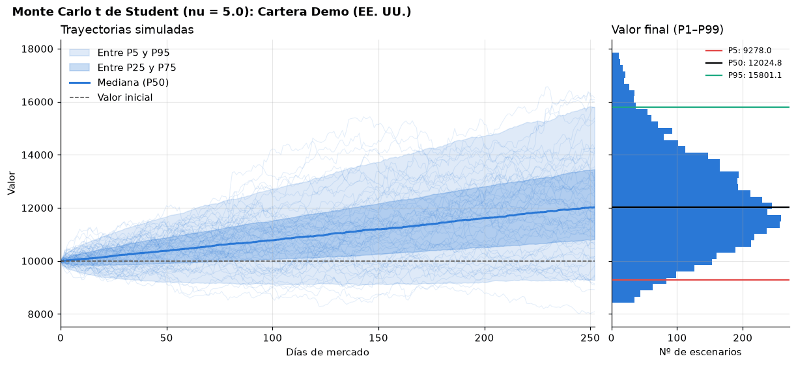

## Informes y gráficos

`cartera.report()` devuelve Markdown y admite `secciones`, `tasa_libre`
anual, `nivel_var`, `benchmark`, `simulacion`, `umbrales` y `ruta` para
guardar el texto. Las secciones disponibles son `resumen`, `composicion`,
`activos`, `correlaciones`, `montecarlo`, `diagnostico` y `advertencias`:

```python
texto = cartera.report(secciones=("resumen", "advertencias"), nivel_var=0.99)
```

El informe incluye rentabilidad total y anualizada, volatilidad, Sharpe,
Sortino, caída máxima, VaR y CVaR históricos y, si hay una referencia con
variación suficiente, la beta. VaR y CVaR se expresan como pérdidas diarias y
pueden ser negativos si incluso los peores rendimientos fueron positivos. Las
métricas que no se pueden estimar aparecen como `n/d`. Los umbrales de las
advertencias son configurables y no son reglas de inversión.

- La anualización supone 252 observaciones por año. Después de alinear, un
  rendimiento puede abarcar más de una sesión; el toolkit no reconstruye ese
  calendario, así que con muchos huecos la anualización es solo aproximada.
- La aportación al riesgo se calcula con los pesos iniciales fijos, que no
  coinciden con la evolución real de los pesos en comprar y mantener.
- La valoración histórica parte de base 100.
- Una simulación incluida en el informe conserva su capital, sus supuestos y
  su periodo de calibración, que el informe muestra por separado; añadir un
  benchmark no la recalibra. También se incluye el diagnóstico de limpieza del
  benchmark.

`cartera.plots_report()` devuelve un diccionario de figuras de Matplotlib.
Permite elegir `graficos` (`rendimiento`, `correlacion`, `evolucion`,
`riesgo`) y configurar `ventana_volatilidad`, `benchmark`, `mostrar` y
`carpeta`. Si no hay sesiones suficientes para la ventana de volatilidad, no
se inventan observaciones.

Salida real con la misma cartera de demostración frente al S&P 500 de FRED.
Extracto de `cartera.report(secciones=("resumen", "advertencias"))`:

```markdown
# Informe de Cartera Demo (EE. UU.)

Periodo: 04/01/2021 a 31/12/2025 (1255 sesiones). Cartera de comprar y mantener.

## Métricas de la cartera

| Métrica | Valor |
| --- | --- |
| Rentabilidad total | 142,25 % |
| Rentabilidad anualizada | 19,46 % |
| Volatilidad anualizada | 16,21 % |
| Ratio de Sharpe (tasa libre 0,00 %) | 1,18 |
| Ratio de Sortino | 1,73 |
| Caída máxima | -17,37 % |
| VaR diario histórico al 95 % | 1,61 % |
| CVaR diario histórico al 95 % | 2,29 % |
| Beta frente a ^GSPC | 0,83 |

## Advertencias de riesgo

- **INFO:** Métricas históricas y escenarios simulados: no garantizan resultados futuros y no incluyen costes ni impuestos.
```

Figuras de `cartera.plots_report()`:

| Evolución y caídas desde máximos | Correlación de rendimientos |
| --- | --- |
| 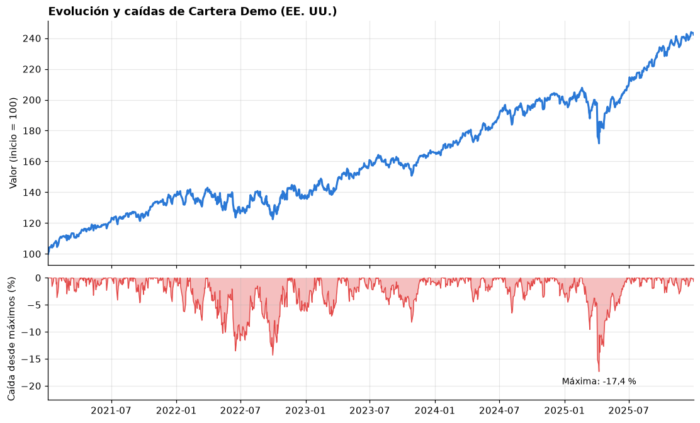 | 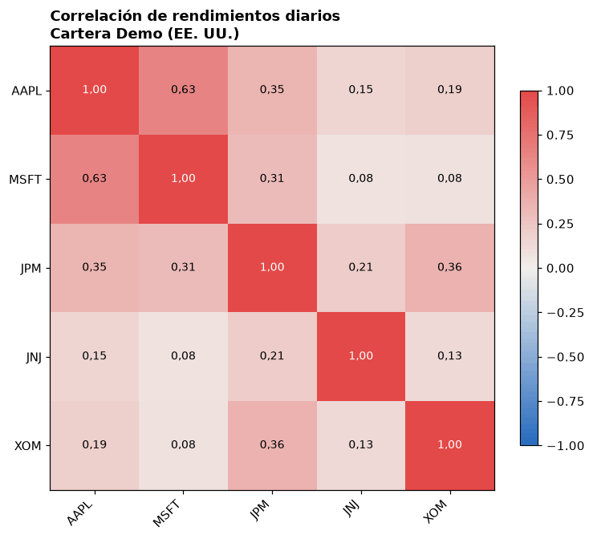 |

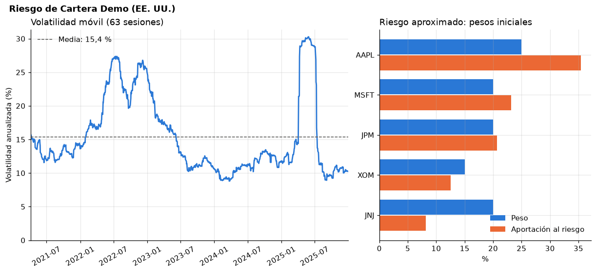

## Dashboard

Aplicación local con Streamlit para explorar el toolkit sin escribir código.
Es un consumidor más de la API pública, como los scripts de `ejemplos/`: usa
`Cartera`, `report()`, `plots_report()`, `SimulationResult` y
`reportes.metricas`, entre otros, y no modifica `src/`. Sus dependencias son
opcionales y `import miax_toolkit` no carga Streamlit ni Plotly.

```powershell
.\.venv\Scripts\python.exe -m pip install -e ".[app]"
.\.venv\Scripts\python.exe -m streamlit run app/dashboard.py
```

La aplicación queda en `http://localhost:8501`; con
`http://localhost:8501/?preset=demo` se abre con la cartera de demostración
ya calculada.

- Datos. El modo *Instantánea*, por defecto, usa los precios reales de
  2021-2025 guardados en `data/sample/` (descargados con el propio toolkit) y
  funciona sin Internet. El modo *En directo* descarga de Yahoo Finance y FRED
  con `descargar_series` y `descargar_sp500_fred`.
- Presets. Cinco empresas de distintos sectores de EE. UU. frente al S&P 500,
  tecnológicas de EE. UU. y una cartera europea en EUR. Cada uno usa una sola
  moneda, porque el toolkit no convierte divisas.
- Páginas. Resumen (indicadores frente al benchmark y advertencias del
  informe), Datos y calidad (contrato de datos y diagnóstico de limpieza),
  Cartera y riesgo, Monte Carlo (abanico de escenarios, valor final y
  comparación de colas t frente a normal), Informe (la salida de `report()` y
  las figuras de `plots_report()` sin modificar) y Arquitectura.
- Errores. Las validaciones son las del toolkit: unos pesos que no suman 100 %
  o una cartera con varias monedas muestran el mensaje de su `ValueError`. Un
  fallo de red (`RuntimeError`) se distingue de una consulta sin datos
  (`ValueError`) y en ese caso se sugiere el modo sin conexión.

Monte Carlo se calibra con las fechas comunes a todos los activos, mientras
que las métricas históricas con benchmark usan además las fechas disponibles
del índice; la página de Monte Carlo muestra su propio periodo de calibración.

Tres series que la API pública no expone (caída desde máximos, volatilidad
móvil y rendimientos diarios) se derivan en `app/transformaciones.py` con las
mismas fórmulas que las figuras del toolkit, y hay pruebas que comprueban que
coinciden.

### Recorrido por la aplicación

Todas las capturas son de la aplicación ejecutándose en local en modo
*Instantánea*, a 1440 × 900.

**Inicio.** Sin configuración aplicada, cada página indica cómo empezar. La
barra lateral agrupa los presets y los tres pasos de configuración: datos,
cartera y simulación.

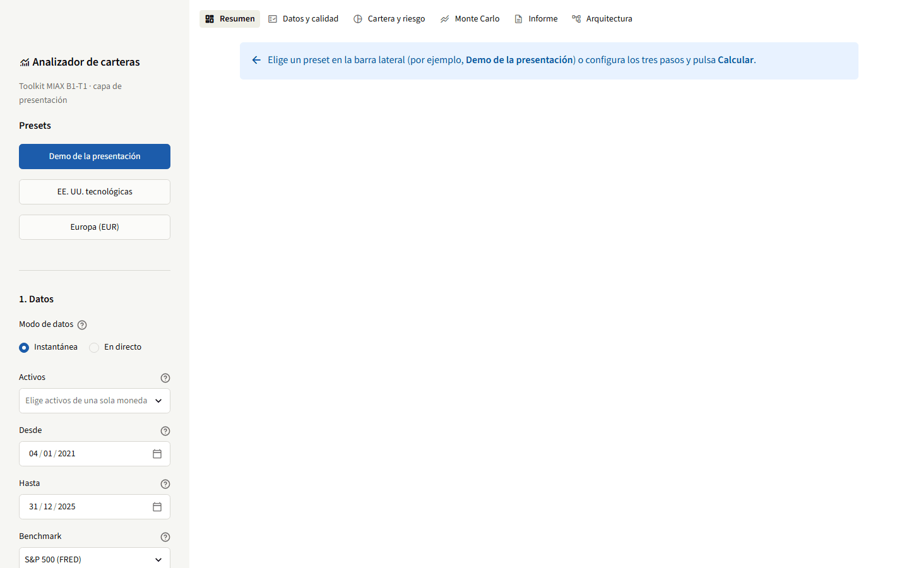

**Resumen.** Indicadores principales con su diferencia frente al benchmark en
las mismas fechas, evolución en base 100 y advertencias del informe.


**Datos y calidad.** Contrato de datos de cada serie (fuente, moneda,
frecuencia, ajuste, unidad y fechas) y el diagnóstico de `alinear_precios`.
En la captura, la cartera europea, con activos de tres bolsas y calendarios
distintos.

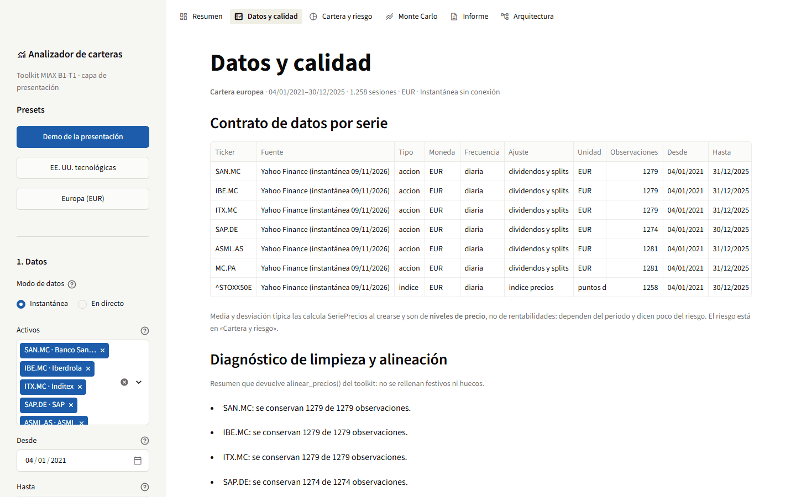

**Cartera y riesgo.** Composición, peso frente a aportación al riesgo,
métricas por activo, correlaciones, caídas desde máximos, volatilidad móvil y
distribución de rendimientos diarios con el VaR y el CVaR.

| Composición y métricas por activo | Caídas y volatilidad |
| --- | --- |
| 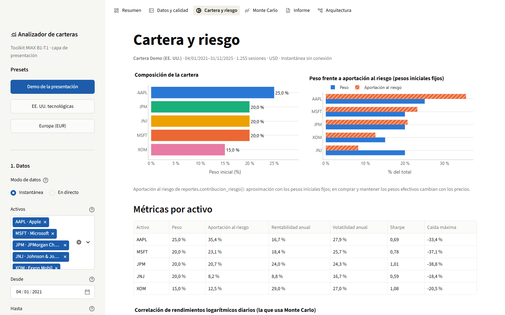 | 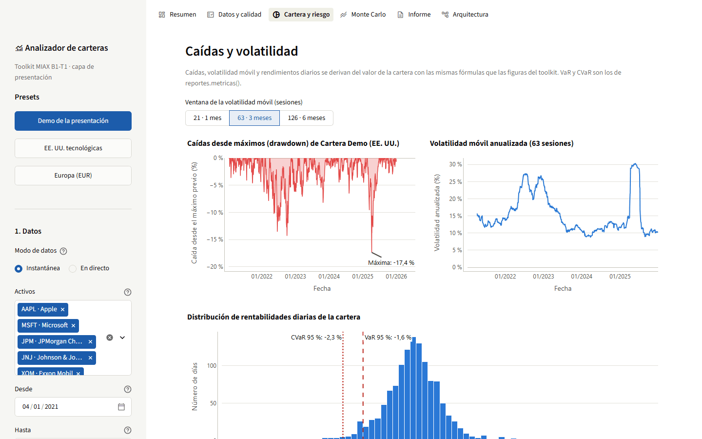 |

**Monte Carlo.** Probabilidad de pérdida y percentiles, abanico de escenarios
e histograma del valor final. El comparador de colas simula la misma cartera
con la misma semilla y `nu = 200` (prácticamente normal) para mostrar el
efecto de la t de Student día a día.

| Escenarios simulados | Comparador de colas |
| --- | --- |
| 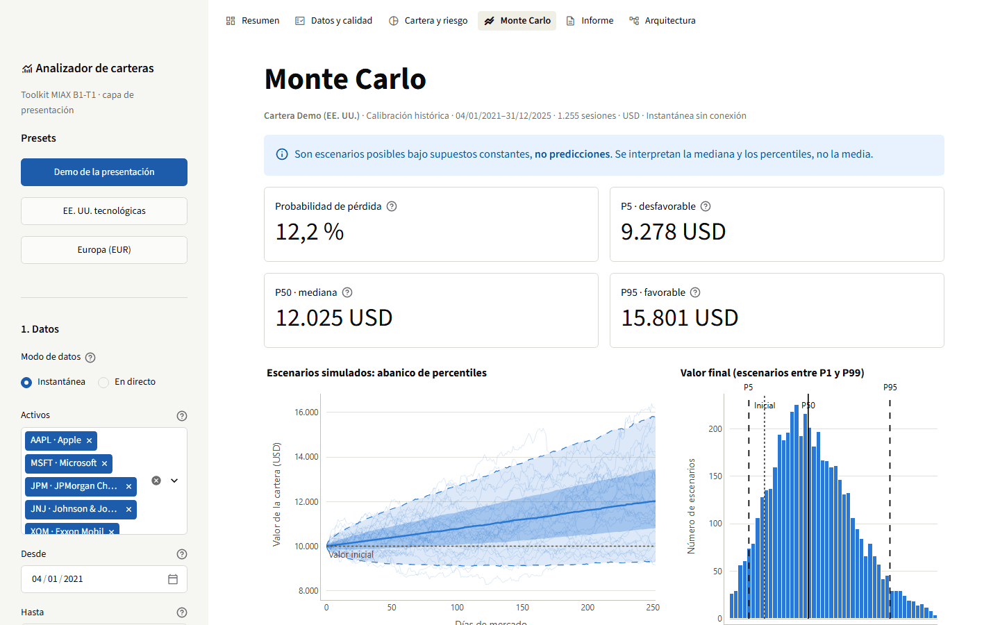 | 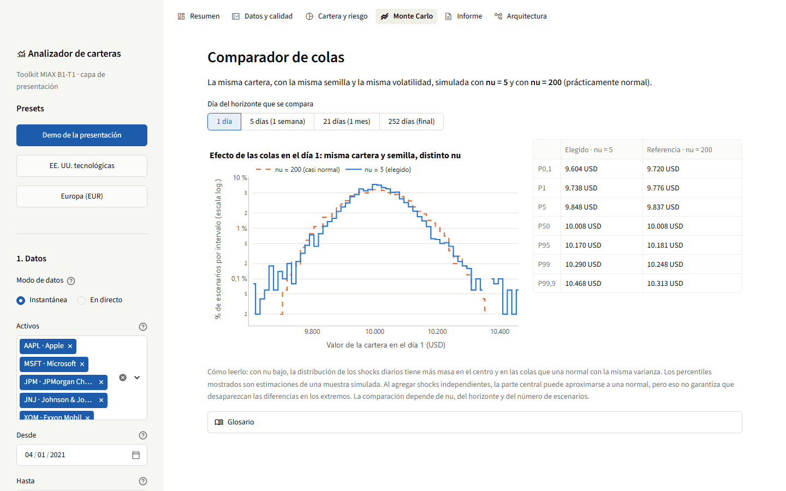 |

**Informe y arquitectura.** El informe es la salida de `report()` sin
modificar, con selección de secciones y descarga en Markdown, seguida de las
figuras de `plots_report()`. La página de arquitectura muestra los diagramas y
la lista de funciones públicas que usa la aplicación, generada a partir de sus
imports.

| Informe | Arquitectura |
| --- | --- |
| 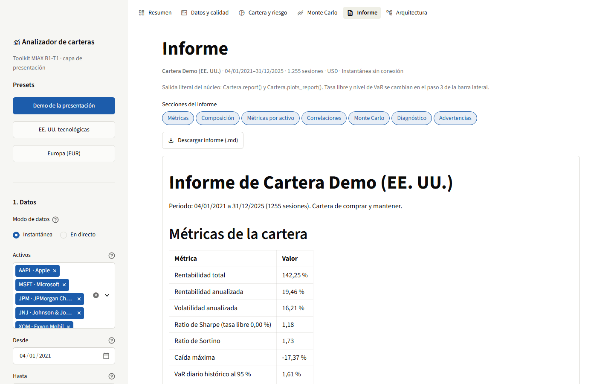 | 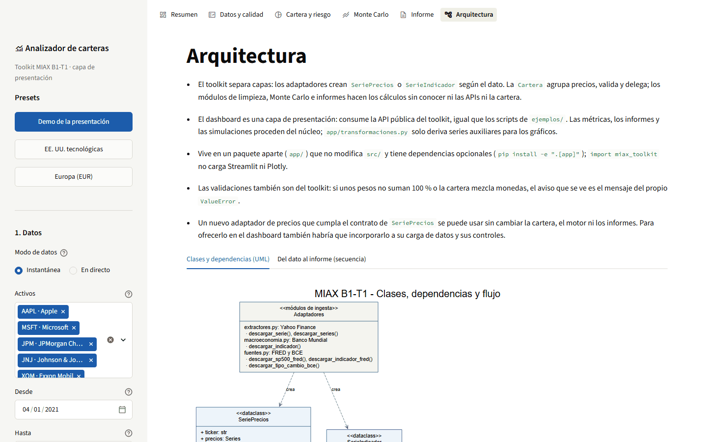 |

**Errores.** En modo *En directo*, un ticker inexistente produce un aviso de
consulta sin datos, distinto del error de conexión, con la sugerencia de usar
la instantánea.

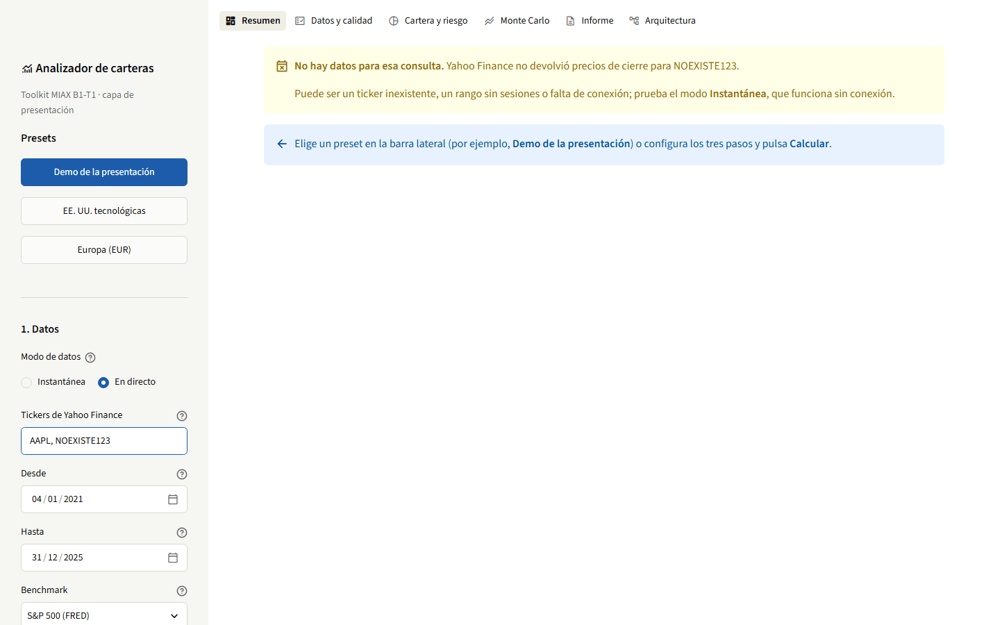

## Arquitectura

```text
src/miax_toolkit/
    __init__.py        API pública
    extractores.py     Yahoo Finance y descarga por lotes
    macroeconomia.py   SerieIndicador y Banco Mundial
    fuentes.py         FRED y BCE
    modelos.py         SeriePrecios
    cartera.py         Cartera y métodos de análisis
    limpieza.py        Limpieza, alineación y validación
    monte_carlo.py     Motor de simulación y SimulationResult
    reportes.py        Informe en Markdown y gráficos
app/                   Dashboard (capa de presentación; no forma parte del paquete)
data/sample/           Instantánea de datos reales para el dashboard
docs/                  Diagramas UML y de secuencia, capturas
ejemplos/              Scripts de demostración
tests/                 Pruebas del toolkit y, en tests/app/, del dashboard
```

El diagrama UML muestra clases, módulos y dependencias. Las flechas
discontinuas significan «usa, crea o delega en», y el rombo vacío indica que
una `Cartera` agrega una o más `SeriePrecios`.


[docs/arquitectura.md](docs/arquitectura.md) explica la notación y la
separación de responsabilidades e incluye un diagrama de secuencia del flujo
completo, desde la descarga hasta el informe.

## Decisiones de diseño

**DataClasses que se validan al crearse.** `SeriePrecios`, `SerieIndicador`,
`Cartera` y `SimulationResult` son `@dataclass` y comprueban sus requisitos en
`__post_init__`. Los controles propios del análisis (frecuencia, moneda y
precios limpios) se aplican antes de cada cálculo. Los objetos son mutables:
modificar un atributo no vuelve a ejecutar `__post_init__`, aunque la cartera
revalida su composición al analizarla.

**Composición y delegación en lugar de herencia.** `Cartera` agrega objetos
`SeriePrecios`, y sus métodos `monte_carlo()`, `report()` y `plots_report()`
preparan los datos con `_preparar_datos()` y delegan el cálculo en módulos de
funciones (`limpieza`, `monte_carlo`, `reportes`) que trabajan con tablas de
pandas y no conocen ni `Cartera` ni las APIs. Cada cálculo se prueba con datos
sintéticos sin construir objetos, el mismo motor sirve para un activo y para
una cartera, y el modelo de simulación se puede cambiar sin tocar las clases
de datos.

**Dos clases de series independientes.** Un indicador macroeconómico no es un
precio y no debe entrar en una cartera. Una clase base común para series
temporales sería posible, pero no hace falta para compartir los atributos del
contrato; `Cartera` comprueba expresamente que sus activos sean `SeriePrecios`.

**Contrato de datos común.** Todo adaptador entrega una `pandas.Series` de
`float` con `DatetimeIndex` sin zona horaria, ordenado y sin fechas
duplicadas, dentro de un objeto con `valores`, `fuente`, `frecuencia` y
`unidad` (y, en precios, `ticker`, `moneda` y `ajuste`). El resto del sistema
depende solo de ese contrato, nunca de la respuesta original de cada API.

**Errores explícitos antes que correcciones silenciosas.** Se rechaza con un
mensaje claro lo que no cumple las restricciones: precios diarios, moneda
común, pesos no negativos que suman uno y un mínimo de observaciones. Los
adaptadores lanzan `RuntimeError` ante fallos de red o del proveedor y
`ValueError` cuando no hay datos o la entrada no es válida.

**t de Student multivariante.** Da colas más gruesas que la normal y mantiene
la correlación entre activos mediante el factor de Cholesky y un mismo
chi-cuadrado para todos los activos en cada día.

## Cómo añadir una fuente de datos

Basta con un adaptador que cumpla el contrato; la cartera, la limpieza, el
motor y los informes no cambian.

1. Escribir la función de descarga en un módulo de ingesta, por ejemplo
   `fuentes.py`, que ya ofrece `_intervalo`, `_csv` y `_normalizar`. Debe
   validar sus argumentos y lanzar `RuntimeError` si falla la red y
   `ValueError` si los datos no son válidos.
2. Normalizar la respuesta al contrato: `Series` de `float` con índice de
   fechas sin zona horaria, ordenado y sin duplicados.
3. Devolver `SeriePrecios` si son precios (con `moneda`, que la cartera exige,
   y `ajuste`) o `SerieIndicador` en otro caso.
4. Exportarla en `src/miax_toolkit/__init__.py` y en `__all__`.
5. Probarla sin Internet, simulando la llamada de red con
   `unittest.mock.patch` (por ejemplo, sobre `requests.get`).

Esqueleto para un proveedor que sirve un CSV con columnas `Date` y `Close` (la
URL es ficticia):

```python
# src/miax_toolkit/fuentes.py
def descargar_precios_mi_proveedor(ticker: str, inicio: str, fin: str,
                                   moneda: str) -> SeriePrecios:
    """Cierres diarios de Mi Proveedor normalizados al contrato común."""
    primero, ultimo = _intervalo(inicio, fin)
    tabla = _csv("https://proveedor.example/precios.csv", {"s": ticker}, "Mi Proveedor")
    precios = _normalizar(tabla, "Date", "Close", primero, ultimo, ticker.upper())
    return SeriePrecios(ticker.upper(), precios, "Mi Proveedor",
                        moneda=moneda, ajuste="no_especificado")
```

Desde ese momento la serie se usa igual que una de Yahoo:
`Cartera("Mixta", [serie_yahoo, serie_nueva], pesos).report()`.

## Pruebas

```powershell
.\.venv\Scripts\python.exe -m pip install -e ".[dev,app]"
.\.venv\Scripts\python.exe -W error -m pytest -q
```

Las pruebas no necesitan Internet: las llamadas a Yahoo, Banco Mundial, FRED y
BCE se simulan con `unittest.mock` y el resto usa datos sintéticos con semilla
fija. Hay un fichero por módulo y, entre otras cosas, comprueban que:

- todas las fuentes devuelven objetos con el mismo contrato de datos;
- la cartera valida pesos, moneda y frecuencia;
- la simulación es reproducible con la misma semilla y la mediana de
  `log(valor final)` de un activo coincide con `log(v0) + retorno · años`;
- el informe y los gráficos se generan y los ficheros de texto están en UTF-8.

Las pruebas del dashboard (`tests/app/`, con `streamlit.testing.v1.AppTest`)
se omiten si no está instalado el extra `app`. Recorren los tres presets sin
conexión, comprueban los errores de consulta, pesos, monedas y tickers
repetidos, y verifican que las cifras mostradas coinciden con las del informe
del toolkit.

## Limitaciones

- La interfaz común de `SeriePrecios` y `SerieIndicador` es una convención, no
  un tipo declarado. Las DataClasses validan sus datos y las pruebas comprueban
  el contrato de los adaptadores; un `typing.Protocol` permitiría además
  verificarlo con análisis estático.
- Los adaptadores son funciones, no clases con una interfaz abstracta común.
  Con cuatro fuentes es suficiente; con más proveedores convendría formalizarlo.
- `descargar_series` descarga los tickers en serie y se detiene en el primer
  fallo: no paraleliza ni devuelve resultados parciales.
- No se convierten divisas: una cartera con varias monedas se rechaza.
- La anualización supone 252 sesiones por año y es aproximada si la historia
  tiene muchos huecos.
- Monte Carlo usa parámetros constantes y no modela costes, impuestos ni
  rebalanceos.
- Los activos de la instantánea del dashboard se eligieron a posteriori, entre
  grandes compañías actuales (sesgo de supervivencia), así que su rentabilidad
  histórica es optimista.

## Trabajo futuro

### Despliegue del dashboard como servicio

Hoy el dashboard se ejecuta en local y se detiene al cerrar la terminal. Para
dejarlo disponible de forma permanente:

1. **Contenedor.** Un `Dockerfile` con Python 3.12 que instale `.[app]` y
   arranque `streamlit run app/dashboard.py --server.address 0.0.0.0
   --server.headless true`, con `HEALTHCHECK` sobre `/_stcore/health`. La
   instantánea va dentro de la imagen, así que el servicio arranca sin depender
   de Yahoo ni de FRED.
2. **Servidor permanente.** Una máquina virtual pequeña (por ejemplo, en Azure,
   AWS o GCP) que ejecute el contenedor con reinicio automático
   (`--restart unless-stopped` o un servicio de systemd). Alternativas
   gestionadas: Azure Container Apps, Google Cloud Run o Streamlit Community
   Cloud.
3. **Acceso.** Un proxy inverso (nginx o Caddy) con HTTPS y autenticación
   delante de Streamlit. El repositorio es privado y los datos del S&P 500
   tienen condiciones de uso, así que no debería quedar expuesto sin control
   de acceso.
4. **Datos actualizados.** Una tarea programada (cron o GitHub Actions) que
   ejecute `python -m app.generar_instantanea`, valide el resultado con las
   pruebas y publique una nueva instantánea, y una caché persistente de
   descargas (Parquet o SQLite) para no consultar a los proveedores en cada
   sesión.
5. **Varios usuarios.** Limitar memoria y escenarios por sesión y mover las
   simulaciones grandes a un proceso de trabajo aparte para que no bloqueen la
   interfaz.

### Mejoras del toolkit

| Área | Mejora | Motivo |
| --- | --- | --- |
| Ingeniería | Integración continua con GitHub Actions: `pytest -W error`, `ruff` y `mypy` en cada pull request. | Detectar regresiones antes de integrar. |
| Ingeniería | Contrato formal de adaptadores con `typing.Protocol` o una clase abstracta. | Comprobar el contrato con análisis estático al crecer el número de fuentes. |
| Ingeniería | Funciones públicas en `reportes` para caídas, volatilidad móvil, beta y advertencias como datos. | El dashboard dejaría de necesitar `app/transformaciones.py`. |
| Ingesta | Descargas en paralelo con reintentos y espera exponencial, y resultados parciales opcionales. | Lotes grandes más rápidos y tolerantes a fallos puntuales. |
| Ingesta | Nuevas fuentes (Alpha Vantage, Finnhub) y datos fundamentales. | Ampliar los tipos de dato sin tocar el análisis. |
| Modelo | Conversión de divisas con `descargar_tipo_cambio_bce`. | Admitir carteras multimoneda. |
| Modelo | Rebalanceo periódico y costes de transacción. | Simular estrategias más realistas que comprar y mantener. |
| Modelo | Volatilidad variable (GARCH), correlaciones dinámicas y *bootstrap* histórico como alternativa a la t de Student. | Capturar agrupamientos de volatilidad y contrastar supuestos. |
| Análisis | Backtesting *walk-forward* y optimización de pesos (mínima varianza, paridad de riesgo). | Evaluar decisiones fuera de muestra. |
| Dashboard | Comparación de varias carteras, exportación del informe a PDF y revisión del tema oscuro. | Uso más allá de la demostración. |

## Correspondencia con el enunciado

| Apartado | Dónde está |
| --- | --- |
| 4.1 Repositorio y despliegue | Este README, `src/`, `pyproject.toml`, `.gitignore`, [Instalación](#instalación) |
| 4.2 Ingesta multifuente | [Fuentes de datos](#fuentes-de-datos): `extractores.py`, `macroeconomia.py`, `fuentes.py`; descarga en lote con `descargar_series` |
| 4.3 Series de precios y cartera | [Cartera, limpieza y validaciones](#cartera-limpieza-y-validaciones): `modelos.py`, `cartera.py` |
| 4.4 Monte Carlo | [Monte Carlo](#monte-carlo): `monte_carlo.py`, `Cartera.monte_carlo()`, `SimulationResult.plot()` |
| 4.5 Limpieza, validación y reportes | [Cartera, limpieza y validaciones](#cartera-limpieza-y-validaciones), [Informes y gráficos](#informes-y-gráficos): `limpieza.py`, `reportes.py` |
| 4.6 Diagramas | [Arquitectura](#arquitectura): `docs/arquitectura.md`, `docs/arquitectura.svg`, `docs/secuencia.svg` |

## Referencias

- [yfinance: consulta de históricos](https://ranaroussi.github.io/yfinance/reference/api/yfinance.Ticker.history.html).
- [Banco Mundial: API de indicadores](https://datahelpdesk.worldbank.org/knowledgebase/articles/889392-about-the-indicators-api-documentation).
- [FRED: descarga de datos](https://fred.stlouisfed.org/help/data/downloading/using-the-download-data-link/),
  [ficha de UNRATE](https://fred.stlouisfed.org/series/UNRATE) y
  [ficha de SP500](https://fred.stlouisfed.org/series/SP500).
- [BCE: ejemplos de la API SDMX](https://data.ecb.europa.eu/help/api/data-examples).
- [Distribución t multivariante](https://docs.scipy.org/doc/scipy/reference/generated/scipy.stats.multivariate_t.html)
  (referencia matemática; el motor está implementado con NumPy y no requiere SciPy).
