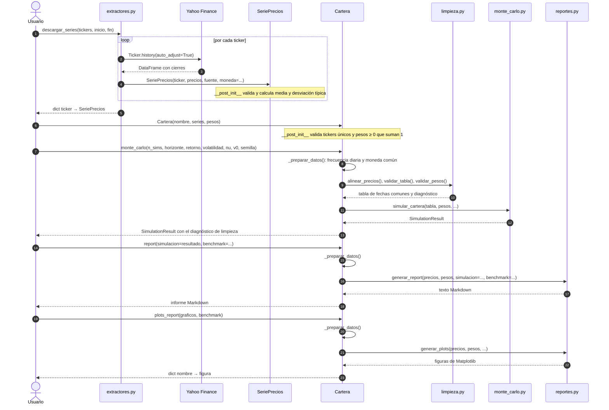

# Arquitectura del toolkit


El diagrama recoge las clases y módulos de `src/miax_toolkit/` y las
dependencias entre ellos. La única relación estructural es la agregación de una
o varias `SeriePrecios` en `Cartera`: una serie existe por sí misma y puede
formar parte de varias carteras. Las demás flechas son dependencias, y su
etiqueta indica si el origen crea, valida o delega en el destino.

| Elemento | Significado |
| --- | --- |
| Línea continua con rombo vacío | Agregación: el rombo está en el todo (`Cartera`); multiplicidades `1..*` (una cartera tiene una o más series) y `0..*` (una serie puede estar en cero o más carteras). |
| Flecha discontinua con punta abierta | Dependencia UML: el origen usa, crea o delega en el destino. Todas corresponden a un `import` real, salvo dos: «crea» de `monte_carlo.py` a `SimulationResult` (la clase está en el mismo fichero) y «consulta opcional», en la que `reportes.py` solo lee el `SimulationResult` que recibe como argumento. |
| `<<dataclass>>` | Clase de datos de Python (`@dataclass`). |
| `<<módulo>>` | Fichero de Python con funciones, no una clase. Se dibuja como caja para mostrar sus dependencias. |
| `+` / `-` | Miembro público / interno (prefijo `_` en Python). |
| `nombre: tipo` | Tipo de dato o resultado; algunas funciones lo documentan sin anotación de Python. `...` indica que se omiten parámetros opcionales. |

No hay herencia entre clases: el diseño se basa en composición y delegación
(véase «Decisiones de diseño» en el README).

## Separación de responsabilidades

Dentro del paquete, solo los adaptadores (`extractores.py`, `macroeconomia.py`
y `fuentes.py`) acceden a las APIs. Cada uno convierte la respuesta del
proveedor en una `SeriePrecios` o una `SerieIndicador`, y ambas clases exponen
`valores`, `fuente`, `frecuencia` y `unidad`, de modo que el resto del código
trata igual cualquier fuente. En `SeriePrecios`, `valores` es una propiedad que
devuelve la propia serie `precios`, sin copiarla, y la media y la desviación
típica se calculan en `__post_init__`, al crear el objeto.

`Cartera` agrupa los activos y sus pesos, valida la composición y prepara los
datos, pero no calcula: delega en `monte_carlo.py` y `reportes.py`. Solo admite
objetos `SeriePrecios`, así que los indicadores macroeconómicos no pueden
entrar en una cartera como si fueran activos de inversión.

El motor de Monte Carlo y el módulo de informes reciben una tabla de precios y
unos pesos, sin conocer las APIs ni importar `Cartera`. Por eso se pueden
probar con datos sintéticos y reutilizar con cualquier fuente. El motor
devuelve un `SimulationResult`, que guarda los escenarios y sabe resumirlos y
dibujarlos; los informes pueden recibir además una simulación ya calculada.
Ambos módulos reutilizan las validaciones de `limpieza.py`.

## Flujo del sistema

1. Un adaptador descarga los datos de Yahoo Finance, el Banco Mundial, FRED o
   el BCE y los devuelve como objeto interno normalizado.
2. Con varias series de precios y sus ponderaciones se construye una `Cartera`.
3. Antes de cada cálculo, la cartera comprueba que todas las series son
   diarias y están en la misma moneda, limpia cada serie y se queda con las
   fechas comunes.
4. El motor de Monte Carlo estima los parámetros con esos precios y devuelve
   un `SimulationResult` con las trayectorias y la distribución del valor final.
5. El módulo de informes genera, con los mismos precios y opcionalmente con la
   simulación, el informe en Markdown y los gráficos históricos de rendimiento,
   correlación, evolución y riesgo.

### Diagrama de secuencia: del dato al informe

El diagrama muestra, en orden temporal, las llamadas reales del caso de uso
principal: descargar acciones de Yahoo, construir la cartera, simularla y
generar el informe. Las flechas continuas son llamadas y las discontinuas,
valores devueltos.



`docs/secuencia.svg` es este mismo diagrama renderizado con mermaid-cli; lo
muestra la página de arquitectura del dashboard y hay que regenerarlo si se
cambia el bloque anterior.

`monte_carlo()`, `report()` y `plots_report()` empiezan llamando a
`_preparar_datos()`, de modo que simulación, informe y gráficos parten de la
misma tabla de precios; después cada método delega en el módulo que hace el
cálculo. Si se pasa un benchmark, el informe y los gráficos restringen además
sus datos a las fechas comunes con esa referencia, lo que no afecta a la
calibración de la simulación.

La simulación llega al informe ya calculada. `report()` comprueba que
corresponde a la cartera (mismo nombre, mismos tickers y mismos pesos), pero no
compara el histórico: si cambian los precios, hay que volver a simular. El
informe muestra las fechas de calibración guardadas en el resultado.

Para un activo individual el flujo es más corto y no pasa por
`_preparar_datos()`: `SeriePrecios.monte_carlo()` limpia la serie con
`limpiar_precios()` y delega en `simular_activo()`, y
`cartera.monte_carlo(activo="AAPL")` reenvía la llamada a ese mismo método.

La media y la desviación típica de `SeriePrecios` se calculan sobre el nivel
de precios y solo describen la serie. La volatilidad y la correlación del
análisis y del Monte Carlo se calculan sobre rendimientos.

Los ejemplos de `ejemplos/` guardan por defecto sus salidas en `resultados/`,
carpeta excluida de Git.

## Regenerar el diagrama de clases

La fuente editable del diagrama UML es [arquitectura.dot](arquitectura.dot).
El SVG se versiona para que se vea directamente en GitHub. Graphviz no hace
falta para usar el toolkit, solo para regenerar el diagrama:

```sh
dot -Tsvg docs/arquitectura.dot -o docs/arquitectura.svg
```

Sin Graphviz instalado, puede usarse
[`@viz-js/viz`](https://www.npmjs.com/package/@viz-js/viz), Graphviz compilado
a WebAssembly para Node.js. Según su cabecera, el SVG actual se generó con
Graphviz 14.1.3.
