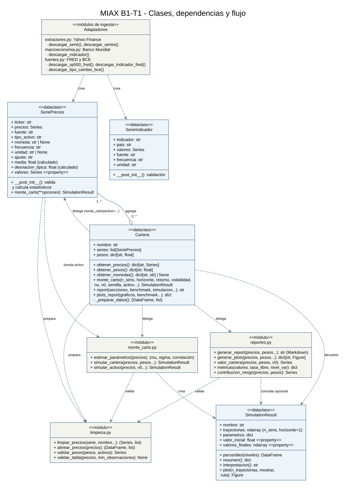
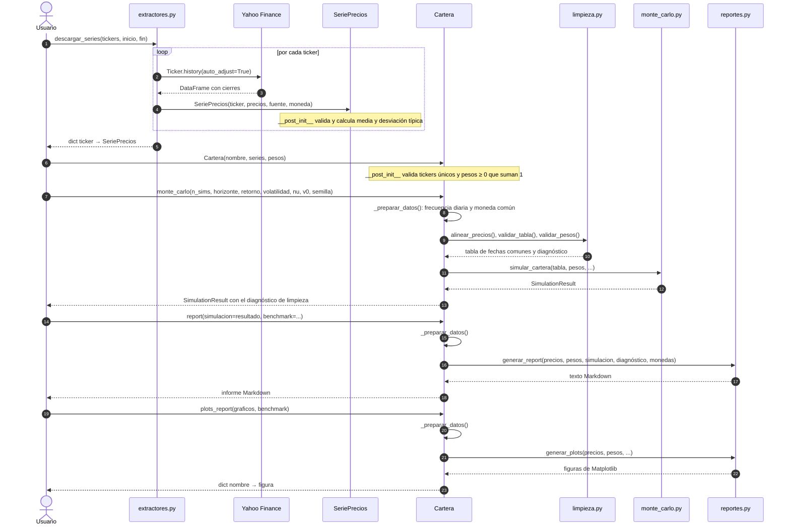

# Arquitectura del toolkit



El rombo vacío representa la agregación de una o varias `SeriePrecios` en
`Cartera`. Una serie existe independientemente y puede utilizarse en varias
carteras. Las flechas discontinuas representan dependencias entre módulos o
clases; las etiquetas indican creación, validación o delegación.

## Separación de responsabilidades

- Los adaptadores convierten respuestas externas en `SeriePrecios` o
  `SerieIndicador`. Ambos ofrecen `valores`, `fuente`, `frecuencia` y `unidad`.
- `SeriePrecios.valores` es una propiedad que accede a `precios`, sin duplicarlos.
  Los estadísticos de precios se calculan automáticamente al crear la serie.
- `Cartera` agrupa los activos y pesos y prepara los datos antes de delegar.
  Los indicadores macroeconómicos no se agregan como activos de inversión.
- El motor recibe precios y pesos, sin conocer APIs ni importar `Cartera`.
  Devuelve `SimulationResult`, que reúne escenarios y visualización.
- Los informes reciben datos ya preparados y, opcionalmente, una simulación.
  No importan `Cartera`. Comparten validaciones y alineación con el análisis.

## Flujo del sistema

1. Yahoo, Banco Mundial, FRED o BCE → adaptador → objeto interno normalizado.
2. Series de precios + ponderaciones → `Cartera`.
3. Cartera → validación de frecuencia y moneda → limpieza y fechas comunes.
4. Precios preparados → motor Monte Carlo → `SimulationResult` → trayectorias
   y distribución del valor final.
5. Precios preparados y simulación opcional → informes → Markdown y gráficos
   históricos de rendimiento, correlación, evolución y riesgo.

### Diagrama de secuencia: del dato al informe

El diagrama muestra, en orden temporal, las llamadas reales del caso de uso
principal: descargar acciones de Yahoo, construir la cartera, simularla y
generar el informe. Las flechas continuas son llamadas y las discontinuas,
valores devueltos.



Puntos que conviene leer en el diagrama:

- **La cartera no calcula, coordina.** `monte_carlo()`, `report()` y
  `plots_report()` pasan por `_preparar_datos()`: simulación, informe y
  gráficos usan exactamente los mismos datos validados y alineados. Después delega en el módulo que sabe
  hacer el cálculo.
- **El motor y los informes no conocen `Cartera` ni las APIs.** Reciben una
  tabla de precios y unos pesos. Por eso se pueden probar con datos sintéticos
  y reutilizar con cualquier fuente.
- **La simulación se pasa al informe, no se recalcula.** `report()` comprueba
  que el `SimulationResult` corresponde a esa cartera y a sus pesos actuales.
- **Para un activo individual** el flujo es más corto:
  `SeriePrecios.monte_carlo()` limpia la serie con `limpiar_precios()` y
  delega en `simular_activo()`. `cartera.monte_carlo(activo="AAPL")` reenvía
  a ese mismo método.

La media y desviación de **precios** se distinguen de la volatilidad y
correlación de **rendimientos** calculadas en el análisis. Los ejemplos guardan
sus salidas en una carpeta excluida de Git.

El [archivo DOT](arquitectura.dot) es la fuente editable del diagrama UML.
El SVG se incluye para que pueda verse directamente en GitHub. Si se desea
regenerarlo con Graphviz (opcional, no necesario para ejecutar el toolkit):

```sh
dot -Tsvg docs/arquitectura.dot -o docs/arquitectura.svg
```
